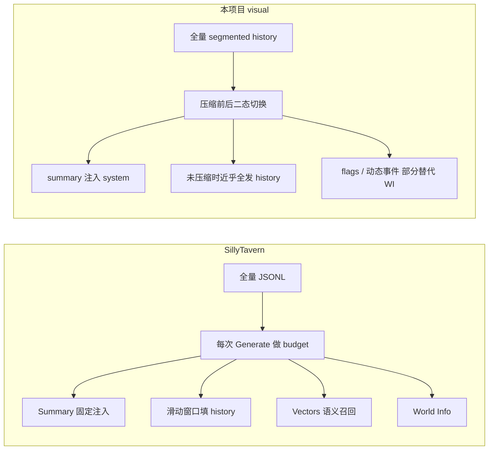

# Visual 模式 Context Memory 现状分析与改进方案

> 对照参考：[SillyTavern 多轮记忆分析](../../SillyTavern/docs/SILLYTAVERN-MULTI-TURN-MEMORY.md)  
> 后端实现：`Interactive-fiction-backend/services/visual/contextMemory.js`  
> 前端消费：`src/hooks/galgame/useGalgameHistory.ts`、`useGalgameController.ts`

---

## 1. 文档目的

本文对比 **SillyTavern 记忆方案** 与 **本项目 Visual/Galgame 模式的 `contextMemory.js`**，说明：

1. 当前架构做了什么、做得好的地方  
2. 主要弊端与风险  
3. 分阶段改进方案与验收指标  

供前后端联调、产品评估与后续迭代使用。

---

## 2. 架构对照总览

### SillyTavern

```text
全量 JSONL 存盘
  → 每次 Generate 按 token budget 组装 prompt
  → Summary（增量扩展）+ 滑动窗口 history
  → 可选 Vectors 语义召回 + World Info 关键词
```

### 本项目 Visual 模式

```text
全量 segmented history（R2/存储）
  → sendActionStream 调用 contextMemory
  → 未压缩：几乎发送 compressedThrough 之后全部 history
  → 压缩后：sessionSummary + 最近约 5 轮原文
  → structured JSON 主要用于压缩链路，未稳定注入主 GM prompt
```



---

## 3. 当前实现（优点）

| 能力 | 实现位置 | 说明 |
|------|----------|------|
| **存档完整** | `services/visual/segmentedStore.js` | 分段持久化全量对话，不因 context 裁剪而删历史 |
| **增量摘要** | `contextMemory.js` → `buildSummaryPrompt` | 旧 summary + 新对话合并，类似 ST「旧 summary 扩展」 |
| **结构化记忆** | `validateContextMemorySummary` | `keyEvents`、`characters`、`openThreads`、`irreversibleEvents` 等，适合游戏态 |
| **校验重试** | 最多 3 次 validation retry | 摘要质量可控 |
| **压缩历史** | `contextMemoryCompressionHistory` | 最近 20 次快照，支持 debug |
| **Budget 概念** | `thresholdTokens`、`safePromptBudgetTokens` | 有推理层 token 预算设计 |
| **前端状态展示** | SSE `context_memory_status` / `context_compression_*` | Galgame 页可展示 memory meter（debug 模式） |

### 主链路

```text
interface/handlers/visual/sendActionStream.js
  → prepareTextModeMemoryPlan()
  → compressTextModeContextMemory()（需要时）
  → trimmedHistory = textModeMemoryResult.promptMessages
  → generateVisualActionOutputWithRetry()

services/visual/gameLogic.js
  → buildVisualGameContext()
  → sessionSummary → savedHistorySection 追加到 system prompt
```

### 前端相关 SSE 事件

| 事件 type | 含义 |
|-----------|------|
| `context_compression_start` | 开始压缩，带 `contextMemory` usage |
| `context_compression_done` | 压缩完成 |
| `context_memory_status` | 当前 memory 状态（tokens、压缩次数等） |
| `CONTEXT_COMPRESSION_FAILED` | 压缩失败，整轮 abort |

前端类型：`src/api/galgame/getGalgamePreset.type.ts` → `ContextMemoryStatus`

---

## 4. 主要弊端（按优先级）

### P0 — 未压缩时几乎不做 sliding window（最严重）

`compressTextModeContextMemory` 在未触发压缩时：

```javascript
return {
  compressed: false,
  promptMessages: plan.uncompressedMessages,  // 自上次压缩点起的全部消息
};
```

- 两次压缩之间可能累积 **多达 ~100 轮**（`safeRoundLimit` 默认 100）完整原文进 LLM。  
- SillyTavern 是 **每一轮** 都按 budget 从新到旧填 history。  
- 我们是 **「要么全发，要么压成 5 轮 + summary」** 的二态切换。

**风险**：中期会话 token/成本暴涨、偶发超窗；压缩前后体验不一致。

---

### P0 — 压缩失败阻断整轮

`sendActionStream.js` 中压缩校验失败 → `CONTEXT_COMPRESSION_FAILED`，玩家无法继续本回合。

SillyTavern 的 summary 为 quiet prompt，失败通常不阻断主对话。

---

### P0 — `structured` 记忆未稳定进入主生成 prompt

压缩产出 rich JSON（角色、线索、不可逆事件等），但主 GM 路径主要使用 `sessionSummary` 纯文本：

```javascript
// gameLogic.js
if (migratedState?.sessionSummary) {
  savedHistorySection = `\n\n## 历史摘要（从存档加载）\n${trimmed}...`;
}
```

`contextMemorySnapshot.structured` **未系统化注入** `buildVisualGameContext`，结构化信息主要在 **下一次压缩** 时使用，对 **当轮叙事** 帮助有限。

---

### P1 — Token 估算粗糙

```javascript
estimateTextTokens(text) = ceil(text.length / 1.8)
```

中英文混排、长 system prompt 误差大，可能该压不压或误触发。

---

### P1 — 压缩后 recent 窗口过小且固定

- `DEFAULT_RECENT_ROUNDS = 5` → 压缩后仅约 5 轮原文。  
- ST 在剩余 budget 内 **尽量多塞** recent messages。  
- 压缩后叙事易变成「summary 驱动」，丢失短期语气细节。

---

### P1 — 触发策略偏滞后

| 维度 | SillyTavern | 本项目 |
|------|-------------|--------|
| 周期触发 | 默认每 10 条消息 | **无** |
| Token 触发 | 摘要输入 fit 上限 | 估算 token > 51% budget |
| 轮数兜底 | 无硬上限 | `safeRoundLimit = 100` |

缺少轻量、周期性摘要，长期依赖单次「大压缩」。

---

### P2 — 多路径不一致

| 路径 | 是否走 contextMemory |
|------|---------------------|
| `sendActionStream.js` | ✅ |
| `regenerate.js` | ❌ |
| `editHistory.js` | ❌（无 `compressedThrough` 重算） |

编辑/重生成可能导致 history 与 summary 边界错位。

---

### P2 — Summary 检查点未挂在 history 消息上

- ST：`mes.extra.memory` 挂在某条消息，边界清晰。  
- 本项目：summary 在 **session state**，与 segmented history **弱绑定**（仅 `compressedThroughMessageCount`）。

---

### P3 — 无语义召回层

无 Vectors / embedding 等价能力；压缩后若细节未写入 summary，难以按语义捞回旧轮。

---

### P3 — World Interaction 未复用

`services/worldInteraction/` 未接入 `contextMemory.js`，长会话能力不统一。

---

## 5. 改进方案（分阶段）

### 阶段 A：Prompt 组装重构（优先级最高，约 1–2 周）

**目标**：对齐 ST「存档完整 + 每次推理做 budget」。

#### A1. 新增统一入口 `buildPromptMessages()`

每次生成都走同一逻辑：

```text
1. fixedBudget   → system + 设定 + flags + 动态事件
2. memoryBudget  → sessionSummary.readableSummary
3. structuredBudget → snapshot 中当轮必需字段
                      (currentState, openThreads, irreversibleEvents, ...)
4. historyBudget → 从新到旧填 messages，直到 token 用尽
5. reserve       → maxOutputTokens + safetyMargin
```

**改动**：

- `prepareTextModeMemoryPlan`：未压缩时也返回 budget 内 history，而非 `uncompressedMessages`。  
- `selectRecentContextMessages`：改为 **token 驱动**，`recentRounds` 仅作下限。

#### A2. structured 记忆注入 GM system

在 `gameLogic.js` 增加 `buildContextMemorySection(state)`，注入：

```text
## 隐藏剧情记忆（系统用）
### 叙事摘要
### 当前状态
### 未解决线索
### 不可逆事件
```

#### A3. 压缩失败降级（非阻断）

```text
压缩失败 →
  1. sliding window + 旧 sessionSummary 继续生成
  2. SSE: context_compression_degraded
  3. 下轮重试压缩
```

**前端配合**：处理 `context_compression_degraded`，meter 显示降级态，不阻断游戏。

---

### 阶段 B：触发与计数优化（约 1 周）

#### B1. 双触发策略

| 触发 | 建议默认 |
|------|----------|
| `promptInterval` | 每 **10 轮** 轻量摘要（可异步） |
| `tokenThreshold` | 保留 51%，可调至 0.45 |
| `safeRoundLimit` | 100 → **30–50** |

#### B2. 改进 token 计数

- 用 LLM 返回的 `prompt_tokens` 校准 `charsPerToken`  
- 或接入 provider tokenizer  
- `buildUsage` 分块计数：system / memory / 每条 message  

---

### 阶段 C：边界与多路径一致（约 1 周）

#### C1. History 检查点

压缩完成时，在 history segment meta 记录：

```json
{
  "contextMemoryCheckpoint": {
    "compressionCount": 3,
    "summaryText": "..."
  }
}
```

对齐 ST `mes.extra.memory`。

#### C2. 统一 regenerate / editHistory

抽取 `prepareVisualTurnContext()`，供：

- `sendActionStream.js`  
- `regenerate.js`  
- `editHistory.js`（编辑后重算边界）  

#### C3. 编辑已压缩区间的策略

- 方案 1：重置 compression，从最近 checkpoint 重建  
- 方案 2：禁止编辑已压缩区间并提示  

---

### 阶段 D：长期增强（可选，2–4 周）

#### D1. 游戏态 Lore 层（替代 ST World Info）

按 `sceneId`、`activeFlags` 从游戏 JSON 筛选相关条目注入 `loreBudget`。

#### D2. 语义召回（Vectors 简化版）

```text
每 N 轮 embed history chunk
Generate 前 query = 最近 3 轮 + userAction
top-k → 注入「相关回忆」块
```

#### D3. World Interaction 复用

将 `contextMemory.js` 抽到 `services/shared/`，WI 模式接入同一 API。

---

## 6. 推荐落地顺序

```text
Week 1   A1 + A3     每次生成都 sliding window；压缩失败不阻断
Week 2   A2 + B2     structured 注入 system；改进 token 计数
Week 3   B1 + C2     周期轻摘要 + regenerate 接入
Week 4   C1 + C3     history 检查点 + 编辑策略
Later    D1 → D2 → D3
```

---

## 7. 配置建议

| 环境变量 | 现默认 | 建议 |
|----------|--------|------|
| `GALGAME_TEXT_MEMORY_RECENT_ROUNDS` | 5 | 5（作下限，主靠 token 填） |
| `GALGAME_TEXT_MEMORY_THRESHOLD_RATIO` | 0.51 | 0.45 |
| `GALGAME_TEXT_MEMORY_SAFE_ROUNDS` | 100 | 40 |
| `GALGAME_TEXT_MEMORY_INTERVAL_ROUNDS` | 无 | **新增** 10 |
| `GALGAME_TEXT_MEMORY_CHARS_PER_TOKEN` | 1.8 | 动态校准 |

---

## 8. 验收指标

| 指标 | 目标 |
|------|------|
| 50 轮会话 | `prompt_tokens` 不随轮数线性暴涨 |
| 100 轮会话 | 主线 / 角色状态仍可追踪 |
| 压缩失败 | 用户仍可继续玩（降级模式） |
| regenerate | 与 action 路径 memory 一致 |
| 成本 | 平均每轮 `prompt_tokens` 较现网降 20–40% |

---

## 9. 前端后续配合项（改进落地时）

| 项 | 说明 |
|----|------|
| SSE `context_compression_degraded` | 压缩失败但不阻断时的 UI 提示 |
| Memory meter | 展示 `usageRatio`、`turnsSinceCompression`、降级态 |
| Debug 面板 | 已有 `contextMemoryDebug`，可展示 structured 摘要与 checkpoint |
| 长会话加载 | `getGalgameHistory` 已带 `contextMemory`，保持与后端字段同步 |

相关文件：

- `src/hooks/galgame/useGalgameController.ts`  
- `src/hooks/galgame/useGalgameHistory.ts`  
- `src/api/galgame/getGalgamePreset.type.ts`  
- `src/page/Galgame.module.css`（`.contextMemoryMeter`）

---

## 10. 相关文档与源码索引

### SillyTavern 参考（兄弟仓库）

| 文档 | 主题 |
|------|------|
| `SillyTavern/docs/SILLYTAVERN-MULTI-TURN-MEMORY.md` | 记忆总览 |
| `SillyTavern/docs/INCREMENTAL-SUMMARY-EXPANSION.md` | 旧 summary 扩展 |
| `SillyTavern/docs/PROMPT-TOKEN-BUDGET.md` | Token budget |
| `SillyTavern/docs/CHAT-JSONL-STORAGE.md` | JSONL 存盘 |

### 本项目后端

| 模块 | 路径 |
|------|------|
| 记忆核心 | `services/visual/contextMemory.js` |
| 动作流 | `interface/handlers/visual/sendActionStream.js` |
| GM prompt | `services/visual/gameLogic.js` |
| History 存储 | `services/visual/segmentedStore.js` |
| 重生成 | `interface/handlers/visual/regenerate.js` |

---

## 11. 一句话总结

**本项目已有「全量存档 + 增量结构化摘要」，游戏向 schema 是优势；最大短板是「未压缩时近乎全量发 history、压缩后窗口又过小」，且 structured 记忆未稳定进入主 prompt。**

优先实现 **每次推理统一的 budget 组装 + structured 注入 + 压缩降级**，再补周期摘要与语义召回，可接近 SillyTavern 长对话效果，并保留游戏结构化记忆的优势。

---

*文档版本：2026-07-02 · 基于 backend `contextMemory.js` 与 SillyTavern docs 静态分析。*
