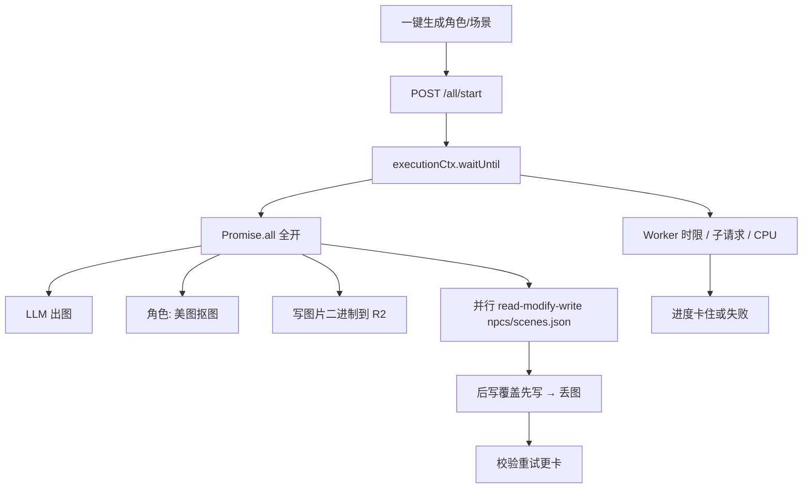

# Cloudflare 批量生图（角色 / 场景）限流与落库方案

> **版本**：v1.0（2026-07-23）  
> **状态**：**一期已落地**（并发 2 + 串行元数据落库 + 单测）；二期 Queue / 三期体验优化待排期  
> **范围**：创作台「一键生成所有角色立绘」「一键生成所有场景立绘」（含世界互动场景/子场景）  
> **关联后端**：`Interactive-fiction-backend/services/visual/batchImageRuntime.js`、`imageGeneration.js`、`interface/handlers/worldInteraction/images.js`

---

## 1. 背景与问题

### 1.1 现象

| 环境 | 表现 |
|------|------|
| 本地 Node / 本机 wrangler | 「一键生成」通常能跑完，体感可接受 |
| Cloudflare Workers 线上 | 特别卡：进度长时间不动、偶发失败、部分立绘丢失、前端轮询到超时 |

两端同一套前端按钮与同一套 `/all/start` 异步 Job 协议，差异主要在 **Worker 执行模型与全开并行**。

### 1.2 前端入口

| UI | 前端调用 | 后端 Job |
|----|----------|----------|
| STEP3「一键生成所有角色立绘」 | `startGenerateAllNpcImages` → poll status/result | `POST /api/visual/generate-images/:fileId/all/start`（NPC+Player，`removeBg: true`） |
| STEP4「一键生成所有场景立绘」 | `startGenerateAllSceneImages` → poll | 视觉：同上（仅 scenes）；世界互动：`.../generate-scenes-subscenes/start` |

前端轮询：约每 **1.5s** 拉一次 job 状态，最长约 600 次（约 15 分钟）。

### 1.3 改造前后端行为（基线）

```text
POST /all/start
  → KV 建 job
  → executionCtx.waitUntil(整批任务)
  → generateAllImages / 世界互动批量
       → Promise.all 全开并行出图
       → 每张图各自 get JSON → 改路径 → put JSON（R2 元数据）
```

---

## 2. 根因分析



| 问题 | 角色批量 | 场景批量 |
|------|----------|----------|
| `Promise.all` 无上限 | Player + 全部 NPC（+ 差分） | 全部 scene（世界互动含 subscene） |
| 元数据写冲突 | `putNpcs` / `putWorld` | `putScenes` / `putGameSceneSetting` |
| 长任务挂在 `waitUntil` | 是 | 是 |
| 额外重活 | 默认 `removeBg: true`（美图同步抠图） | 一般无抠图，但仍并行出图+写盘 |
| 重复读上下文 | 每个角色 `extractGameContext` | 每个场景重复读世界设定 |

本地「没问题」往往是：进程更耐跑、无 Worker 时限、并行冲突更少、外网到生图/抠图更稳。

---

## 3. 方案总览（三期）

| 期次 | 目标 | 状态 |
|------|------|------|
| **一期** | 并发默认 **2**；元数据 **串行落库**；批任务复用 `gameContext`；角色+场景一起改 | ✅ 已落地 |
| **二期** | 长任务改 **Queue / 分片 waitUntil / DO**，降低整批被掐风险；支持中断续跑 | 待排期 |
| **三期** | 抠图策略、Meitu base64 编码、前端轮询退避、上传超时（存图 60–120s） | 待排期 |

产品拍板（2026-07-23）：

1. Cloudflare 并发默认 **2**（更稳）  
2. **角色 + 场景一期一起改**  
3. **所有修改需完整单测**

---

## 4. 一期落地说明（当前代码）

### 4.1 统一运行时

后端模块：`services/visual/batchImageRuntime.js`

| API | 作用 |
|-----|------|
| `DEFAULT_BATCH_IMAGE_CONCURRENCY = 2` | 默认并发 |
| `resolveBatchImageConcurrency(env)` | 读 `BATCH_IMAGE_CONCURRENCY`（或 `BATCH_IMAGE_CONCURRENCY_LIMIT`），钳制在 1～8 |
| `mapWithConcurrency(items, n, mapper)` | 有限并发 map，保持顺序 |
| `createSerialQueue()` | 串行执行回调，保证 JSON read-modify-write 不互相覆盖 |

`cf/wrangler.toml`：

```toml
BATCH_IMAGE_CONCURRENCY = "2"
```

### 4.2 视觉批量 `generateAllImages`

文件：`services/visual/imageGeneration.js`

- 场景 / NPC / 差分：`mapWithConcurrency(..., concurrency)`，不再 `Promise.all` 全开  
- Player / NPC / Scene / Variant 落库：走同一 `metaQueue.run(...)`  
- 批任务开头一次 `extractGameContext`，下游复用  

覆盖前端两条「一键」：

- 角色：`generateNPCs + generatePlayer`（`removeBg: true`）  
- 场景：`generateScenes`（视觉路径）

### 4.3 世界互动场景批量

文件：

- `interface/handlers/worldInteraction/images.js`（批执行器）  
- `services/worldInteraction/imageGeneration.js`（`generateSceneImage` / `generateSubsceneImage` 支持 `metaQueue`）

场景 + 子场景合并进同一并发池（默认 2），元数据串行写 `scenes.json`。

### 4.4 未改（一期刻意保留）

- 前端 start → poll → result 协议不变  
- 积分预检 / 扣点逻辑不变  
- 单张生成接口行为基本不变（未强制走并发池）  
- 任务仍由 `waitUntil` 挂起（二期再升级）

---

## 5. 单测

| 侧 | 命令 | 覆盖 |
|----|------|------|
| BE | `npm run test:batchImageRuntime` | 默认并发 2、env 覆盖与钳制、并发不超限、串行队列、无锁丢图/有锁不丢、角色式流水线 |

测试文件：`Interactive-fiction-backend/checks/batchImageRuntime.check.mjs`

---

## 6. 验收清单

### 一期（已实现逻辑验收）

- [x] 批量角色 / 视觉场景 / 世界互动场景共用限流 + 串行落库  
- [x] 默认并发 2，可用 env 调整  
- [x] `npm run test:batchImageRuntime` 通过  

### 线上回归（部署后人工）

- [ ] Cloudflare 上「一键生成所有角色立绘」：进度单调上涨，结束后刷新立绘齐全  
- [ ] Cloudflare 上「一键生成所有场景立绘」：同上  
- [ ] 多角色（≥5）/ 多场景（≥5）不出现大面积丢图  
- [ ] 积分扣减与成功张数一致（与改造前规则一致）

### 二期（待做）

- [ ] Queue（推荐）或分片 `waitUntil` / DO  
- [ ] Job `heartbeatAt` + 前端「仍在处理」  
- [ ] 中断后「只补缺图」续跑  

### 三期（待做）

- [ ] 角色抠图：串行 / 失败仍存原图 / 可选关闭  
- [ ] Meitu base64 高效编码  
- [ ] 前端轮询指数退避；存图上传超时 60–120s  

---

## 7. 关键路径速查

### 前端

| 路径 | 说明 |
|------|------|
| `src/components/GameSettingEditor/CharactersPanel/handlers.ts` | 角色批量 start + poll |
| `src/components/GameSettingEditor/CharactersPanel/apiHelpers.ts` | `startGenerateAllNpcImages` 参数 |
| `src/components/GameSettingEditor/ScenesPanel/handlers.ts` | 场景批量 start + poll |
| `src/components/GameSettingEditor/ScenesPanel/apiHelpers.ts` | `startGenerateAllSceneImages` |
| `src/api/galgame/EditorData.ts` | `/all/start`、job status/result |

### 后端

| 路径 | 说明 |
|------|------|
| `services/visual/batchImageRuntime.js` | 并发 / 串行工具 |
| `services/visual/imageGeneration.js` | `generateAllImages` 一期改造 |
| `interface/handlers/visual/images.js` | visual batch job start / waitUntil |
| `interface/handlers/worldInteraction/images.js` | 世界互动场景批量 |
| `services/worldInteraction/imageGeneration.js` | 场景/子场景落库 + `metaQueue` |
| `checks/batchImageRuntime.check.mjs` | 单测 |
| `cf/wrangler.toml` | `BATCH_IMAGE_CONCURRENCY` |

---

## 8. 运维备忘

- 若线上仍偶发整批中断：优先排 **二期 Queue**，不要先盲目把并发调到 3+。  
- 临时调并发：改 `BATCH_IMAGE_CONCURRENCY` 后重新部署 Worker。  
- 排查丢图：对比 job `completedCount` 与 R2 上 `npcs.json` / `scenes.json` 是否缺 `image` 路径；一期后应明显减少「成功了但路径被覆盖」类问题。
