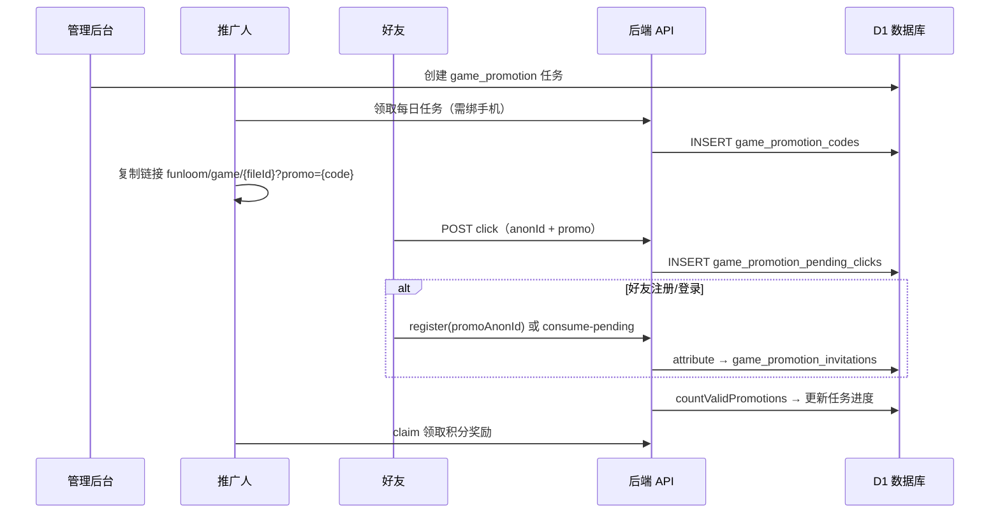

# 游戏推广码 — 逻辑与数据库说明

本文档说明「游戏推广每日任务」中 **推广码** 的生成、存储、归因与进度统计，便于前后端联调与排障。

- **数据库**：Cloudflare **D1**（SQLite）
- **后端仓库**：`Interactive-fiction-backend`
- **前端仓库**：`Interactive-fiction-frontend`

---

## 1. 核心 JS 文件（后端）

| 文件路径（相对 backend 根目录） | 职责 |
|--------------------------------|------|
| `services/d1/gamePromotionLogic.js` | **纯逻辑**：8 位码派生算法、推广链接路径格式、邀请归因有效性判定（自邀 / 已玩过 / 重复归因等） |
| `services/d1/gamePromotionService.js` | **主服务**：生成与查询推广码、记录 pending 点击、执行归因、统计有效推广人数 |
| `services/d1/gamePromotionSchema.js` | **建表**：`ensureGamePromotionSchema()` 在运行时创建/确保推广相关表存在 |
| `services/d1/userGameVisitService.js` | 记录并查询用户是否访问过某游戏（归因前校验「是否已玩过」） |
| `interface/handlers/auth/authDailyTasks.js` | 领取推广任务时生成码；任务状态返回 `promotionCode`；按任务统计进度 |
| `interface/handlers/promotion/gamePromotionDailyTask.js` | 推广相关 HTTP 接口：点击、归因、消费 pending |
| `interface/handlers/auth/authAuth.js` | 注册时若带 `promoAnonId`，消费未注册用户的 pending 点击 |
| `interface/handlers/admin/dailyTasks.js` | 管理后台创建 `task_kind = game_promotion` 的任务配置 |

**单测（A/B）**：`checks/gamePromotionDailyTask.check.mjs`  
运行：`cd Interactive-fiction-backend && npm run check:game-promotion`

---

## 2. 前端相关文件

| 文件路径（相对 frontend 根目录） | 职责 |
|----------------------------------|------|
| `src/utils/gamePromotionLink.ts` | **推广链接拼接**：`{当前 origin}/funloom/game/{fileId}?promo={code}` |
| `src/utils/promoAnonId.ts` | 未登录用户匿名 ID（localStorage），用于 pending 点击与注册归因 |
| `src/api/promotion/gamePromotionApi.ts` | 调用后端推广 API |
| `src/page/Profile.tsx` | 每日任务弹窗：复制推广链接（用 `buildGamePromotionLink` 实时生成） |
| `src/page/GameDetail.tsx` | 解析 URL `?promo=`，记录点击；登录后归因 |
| `src/components/DailyTasksAdminManager.tsx` | 管理后台配置「游戏推广任务」 |
| `src/components/AuthModal.tsx` | 注册传 `promoAnonId`；登录后 `consume-pending` |

### 推广链接格式

复制时**必须**用当前站点域名，不要用后端返回的兜底域名：

```
{window.location.origin}/funloom/game/{gameFileId}?promo={8位码（0-9a-z）}
```

示例（本地）：

```
http://localhost:5173/funloom/game/f9ad05509d128b2e9e5ba0bd8a2a86cb?promo=38134293
```

与 `vite.config.ts` 的 `base: '/funloom/'`、`App.tsx` 的 `BrowserRouter basename='/funloom'` 一致。

---

## 3. 数据库表（D1）

**迁移 SQL**：`Interactive-fiction-backend/cf/migrations/2026-07-02-game-promotion-daily-task.sql`  
**运行时定义**：`services/d1/gamePromotionSchema.js`

### 3.1 `game_promotion_codes` — 推广码本体

| 字段 | 说明 |
|------|------|
| `user_id` | 推广人 userId |
| `game_file_id` | 游戏 fileId |
| `promotion_code` | 8 位推广码（小写字母 `a-z` + 数字 `0-9`） |
| `phone_number_snapshot` | 生成时手机号脱敏快照 |

**约束**：

- `UNIQUE(user_id, game_file_id)` — 同一用户、同一游戏只有一个码
- `UNIQUE(promotion_code)` — 推广码全局唯一

**生成时机**：用户领取 `game_promotion` 类型每日任务且已绑定手机号时，调用 `GamePromotionService.ensurePromotionCode()`。

**生成算法**：`phoneNumber + gameFileId + userId + salt` → HMAC-SHA256 → 按 36 进制（`0-9a-z`）派生 8 位码（见 `gamePromotionLogic.js` 的 `derivePromotionCodeFromBuffer`）。

---

### 3.2 `game_promotion_invitations` — 邀请 / 归因记录

每次点击链接后的归因尝试都会插入一条记录。

| 字段 | 说明 |
|------|------|
| `promotion_code` | 使用的推广码 |
| `promoter_user_id` | 推广人 |
| `game_file_id` | 游戏 |
| `daily_task_id` | 关联的每日任务配置 ID |
| `invitee_user_id` | 受邀人（登录后） |
| `invitee_anon_id` | 受邀人匿名 ID（未登录点击时） |
| `invitee_phone_snapshot` | **受邀人**手机号脱敏快照（如 `186****7561`），归因时写入，便于追溯 |
| `status` | `valid` / `invalid_self` / `invalid_already_played` / `invalid_duplicate` / `invalid_expired` / `invalid_code` 等 |
| `clicked_at` | 点击推广链接时间 |
| `attributed_at` | 归因时间 |
| `accepted_at` | **接受邀请时间**（与 `attributed_at` 一致，归因成功或失败都会记录，便于审计） |
| `promoter_accepted_at` | 推广人领取任务时间 |
| `day_key` | 归因日（UTC+8） |

**进度统计**：`GamePromotionService.countValidPromotions()` 统计 `status = 'valid'` 且满足任务领取日、推广人 `accepted_at` 之后的记录数。

> **追溯受邀人**：请查 `game_promotion_invitations`，不要查 `game_promotion_codes`。后者只存**推广人**自己的码与手机号快照；受邀人信息在邀请归因表里。

---

### 3.3 `game_promotion_pending_clicks` — 未注册点击暂存

| 字段 | 说明 |
|------|------|
| `invitee_anon_id` | 浏览器匿名 ID |
| `promotion_code` | 推广码 |
| `promoter_user_id` / `game_file_id` | 推广人与游戏 |
| `clicked_at` | 点击时间 |
| `consumed_at` / `consumed_by_user_id` | 注册/登录消费后填写 |

**约束**：`UNIQUE(invitee_anon_id, promotion_code)`

---

### 3.4 `user_game_visits` — 用户访问游戏记录

| 字段 | 说明 |
|------|------|
| `user_id` + `game_file_id` | 唯一 |
| `first_visited_at` / `last_visited_at` | 首次 / 最近访问 |
| `visit_source` | 来源：`detail` / `entry` / `promo` 等 |

用于判断受邀人是否在点击推广链接**之前**已访问过该游戏（已玩过则不计有效推广）。

写入来源：游戏详情埋点、进入游戏埋点、推广归因成功时。

---

### 3.5 关联表（任务配置，非推广码表）

| 表 | 作用 |
|----|------|
| `daily_task_configs` | 管理员配置；`task_kind = 'game_promotion'`，含 `target_count`（推广人数目标） |
| `user_daily_task_records` | 用户领取任务时快照 `target_count`、`accepted_at`；记录进度与领奖状态 |

---

## 4. HTTP 接口

| 方法 | 路径 | 登录 | 说明 |
|------|------|------|------|
| POST | `/api/auth/promotion/game/click` | 否 | 记录推广链接点击（body: `promotionCode`, `anonId`） |
| POST | `/api/auth/promotion/game/attribute` | 是 | 对已登录用户执行归因 |
| POST | `/api/auth/promotion/game/consume-pending` | 是 | 登录/注册后消费该 `anonId` 的 pending 点击 |
| POST | `/api/auth/tasks/daily/accept` | 是 | 领取推广任务并生成推广码 |
| GET | `/api/auth/tasks/daily-status` | 是 | 任务列表含 `promotionCode`、`gameFileId` |
| POST | `/api/analytics/game-detail-view` | - | 详情页访问（同步写 `user_game_visits`） |
| POST | `/api/analytics/game-entry` | - | 进入游戏（同步写 `user_game_visits`） |

---

## 5. 业务流程



---

## 6. 有效推广判定规则（图3 逻辑）

`gamePromotionLogic.js` → `evaluateGamePromotionInvitation()`：

| 条件 | 结果 |
|------|------|
| 推广人 = 受邀人 | `invalid_self` |
| 受邀人此前已访问过该游戏 | `invalid_already_played` |
| 该游戏已有他人有效归因 | `invalid_duplicate` |
| 归因时间早于推广人领取任务时间 | `invalid_expired` |
| 以上均不满足 | `valid` |

---

## 7. 产品约定（已实现）

1. **领取时快照** `target_count`，管理员后续改配置不影响已领取用户。
2. **领取推广任务需绑定手机号**。
3. **同一用户 + 同一游戏 = 一个推广码**；不同 `daily_task_id` 分别计有效邀请数。
4. **推广链接域名**取当前访问站点 `window.location.origin`，路径固定 `/funloom/game/{fileId}`。

---

## 8. 本地 D1 数据位置

Wrangler 本地开发时，SQLite 文件通常在：

```
Interactive-fiction-backend/cf/.wrangler/state/v3/d1/.../*.sqlite
```

可用 `sqlite3` 或 D1 控制台查询上述表。

---

## 9. 相关文档

- 产品与测试用例：`docs/GAME-PROMOTION-DAILY-TASK-PLAN.md`（同 frontend `docs` 目录）
