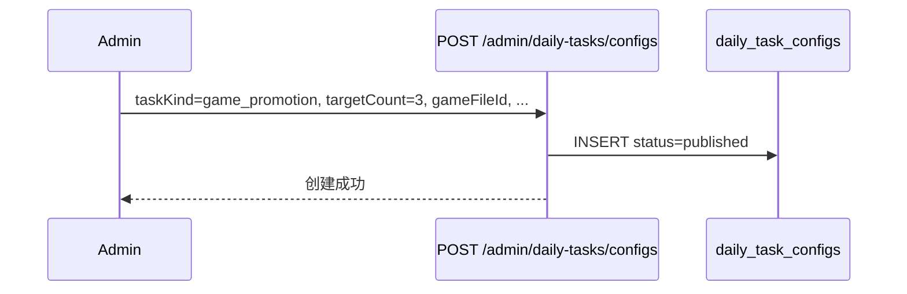
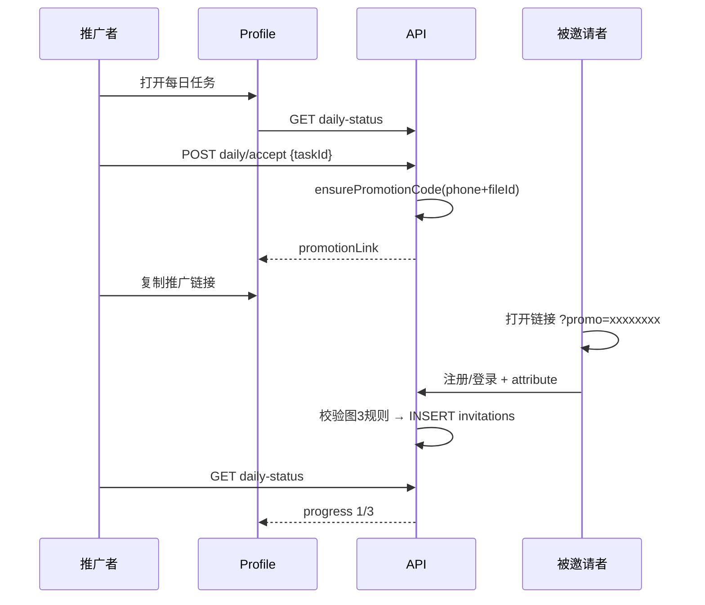

# 游戏推广任务 — 产品方案与测试用例

> 需求来源：管理员新增「游戏推广任务」；用户中心展示推广链接；有效邀请规则参照「游戏活动推广邀请」流程图（图3）。  
> 关联模块：每日任务（`daily_task_configs`）、用户中心 Profile、游戏入口归因。

---

## 1. 需求摘要

| 项 | 说明 |
|----|------|
| 管理端 | 任务类型下拉新增 **「游戏推广任务」**；选中后 **「目标次数」→「推广次数」**；其余字段与「游玩次数任务」一致 |
| 用户端 | 用户中心「每日任务」展示 **「{游戏名}推广任务」**；领取后可 **复制推广链接**（含个人 8 位推广码） |
| 后端 | 单独建表存推广码与邀请记录，便于后期活动统计 |
| 有效规则 | 参照图3「游戏活动推广邀请」分支 |

---

## 2. 与现有「游玩次数任务」对比

| 维度 | 游玩次数任务 `play_specific_game` | 游戏推广任务 `game_promotion`（新增） |
|------|-----------------------------------|--------------------------------------|
| 绑定作品 | ✅ `gameFileId` | ✅ 相同 |
| 需领取 | ✅ | ✅ |
| 进度含义 | 被邀请者 **自己玩** 该游戏次数 | **有效邀请他人** 次数 |
| 进度数据源 | `user_analytics_events.game_entry` | 新表 `game_promotion_invitations` |
| 目标次数变更 | 随配置实时变 | **领取时快照** `target_count`，后台记录 `accepted_at` |
| 推广码 | — | **同一游戏共用一码**（`user_id + game_file_id`） |
| 用户动作 | 「去游玩」 | 「复制推广链接」 |
| 目标字段 | `targetCount`（UI：目标次数） | `targetCount`（UI：**推广次数**） |

---

## 3. 有效邀请规则（图3 落地）

### 3.1 分支：未注册平台用户

```text
点击推广链接
  → 完成注册/登录（链接携带 promotion_code + game_file_id）
  → 【有效邀请】（无论是否立即进入游戏）
```

> 图3 两条路径（玩了 / 没玩）均记 **有效邀请**。实现上：**注册成功且归因到推广码即记有效**，不要求当日必须进入游戏。

**未注册归因窗口（已确认）**：被邀请者须在 **点击链接后、管理员配置的时长内** 完成注册，方计有效。超时记 `invalid_expired`。配置项见 §5.4 `registration_window_hours`。

### 3.2 分支：已注册平台用户

| 条件 | 结果 |
|------|------|
| 从未访问过该游戏（`user_game_visits` 无记录） | **有效邀请** |
| 该用户在该游戏上已被 **其他推广者** 有效邀请过 | **重复邀请无效** |
| 用户曾 **自行** 访问过该游戏（推广归因前已有访问记录） | **邀请无效** |
| 用户点击 **自己的** 推广链接 | **邀请无效**（自推） |

### 3.3 「打开/访问过游戏」判定（已确认）

**不依赖** `user_analytics_events.game_entry` 单点判断。

新建 **`user_game_visits`** 表，记录用户访问过的游戏（去重）：

- 进入游戏详情页、开始游玩、会话创建等入口 **统一写入**
- `UNIQUE(user_id, game_file_id)`，保留 **首次访问时间** `first_visited_at`
- 归因时：若 `first_visited_at < 本次推广点击/注册归因时间` 且 **非本次推广链接触发**，则 `invalid_already_played`

### 3.4 重复邀请

同一 **`invitee_user_id + game_file_id`** 全局仅 **第一个** 有效推广者计分；后续推广者记 `invalid_duplicate`。

---

## 4. 推广码与链接设计

### 4.1 推广码生成

**时机**：用户 **领取推广任务** 时生成并持久化（**须已绑定手机号**，否则拒绝领取）。

**输入**：

- `user.phoneNumber`（**必填**，未绑定不可领取）
- `game_file_id`（任务绑定作品）

**输出**：**8 位数字** `promotion_code`（如 `38472910`）

**算法建议**：

```text
base = HMAC-SHA256(server_secret, normalize(phone) + "|" + game_file_id + "|" + user_id)
code = (base as bigint) % 90000000 + 10000000   // 保证 8 位且首位非 0
若 promotion_code 全局冲突 → salt 递增重算（最多 N 次）
```

**约束（已确认）**：

- `(user_id, game_file_id)` **唯一** → **同一游戏无论有多少个推广任务，共用同一个推广码**
- `promotion_code` **全局唯一**
- 进度按 **`daily_task_id` 分别统计**；码与任务配置解耦，只与「推广者 + 游戏」绑定

### 4.2 推广链接格式

```text
{ORIGIN}/game/{gameFileId}?promo={promotionCode}
```

示例：

```text
https://example.com/game/abc123file?promo=38472910
```

**说明**：

- `promo` 参数用于归因；服务端根据 `promotion_code` 反查推广者与游戏。
- 小程序 / WebView 环境复制完整 URL；微信内可走现有外链复制弹窗逻辑。

### 4.3 用户中心展示（图4）

领取任务后，任务卡片展示：

```text
标题：{gameTitle}推广任务        +12积分
描述：{管理员配置的 description}
进度：有效邀请 0/1
按钮：复制推广链接
```

未领取：按钮「领取任务」  
达标未领奖励：「领取奖励」  
已领取奖励：「已领取」

---

## 5. 数据库设计（新建表）

> 文件建议：`services/d1/gamePromotionSchema.js` + migration SQL

### 5.1 `game_promotion_codes` — 推广码主表

| 字段 | 类型 | 说明 |
|------|------|------|
| `id` | INTEGER PK | |
| `user_id` | TEXT NOT NULL | 推广者 |
| `game_file_id` | TEXT NOT NULL | 绑定游戏 |
| `promotion_code` | TEXT NOT NULL | 8 位数字，**UNIQUE** |
| `phone_number_snapshot` | TEXT | 生成时手机号快照（脱敏存储可选） |
| `created_at` / `updated_at` | TEXT | |

> **不含** `daily_task_id`：同一游戏多任务 **共用一码**，任务维度在邀请流水表区分。

**索引 / 约束**：

- `UNIQUE(user_id, game_file_id)`
- `UNIQUE(promotion_code)`
- `INDEX(game_file_id)`

### 5.2 `game_promotion_invitations` — 邀请/归因流水（统计核心）

| 字段 | 类型 | 说明 |
|------|------|------|
| `id` | INTEGER PK | |
| `promotion_code` | TEXT NOT NULL | |
| `promoter_user_id` | TEXT NOT NULL | 推广者 |
| `game_file_id` | TEXT NOT NULL | |
| `daily_task_id` | INTEGER | 对应任务配置 |
| `invitee_user_id` | TEXT | 被邀请者（注册后写入） |
| `invitee_anon_id` | TEXT | 未登录点击时的匿名 ID（可选） |
| `status` | TEXT NOT NULL | 见下表 |
| `invalid_reason` | TEXT | 无效原因枚举 |
| `attributed_at` | TEXT NOT NULL | 归因完成时间 |
| `promoter_accepted_at` | TEXT | 推广者领取任务时间（进度仅计此后） |
| `day_key` | TEXT | UTC+8 日期，便于按日统计 |
| `created_at` / `updated_at` | TEXT | |

**status 枚举**：

| status | 含义 |
|--------|------|
| `valid` | 有效邀请 |
| `invalid_self` | 自己点自己的链接 |
| `invalid_already_played` | 被邀请者此前已自行玩过该游戏 |
| `invalid_duplicate` | 该用户在该游戏已被其他推广者有效邀请 |
| `invalid_expired` | 任务不在有效期 / 未发布 / **超过注册归因窗口** |
| `invalid_code` | 推广码不存在 |
| `invalid_window` | 点击链接后未在管理员配置的时长内完成注册 |

**索引**：

- `INDEX(promoter_user_id, game_file_id, status, attributed_at)`
- `INDEX(invitee_user_id, game_file_id)`
- `UNIQUE(invitee_user_id, game_file_id) WHERE status='valid'`（SQLite 可用 partial index 或应用层保证）

### 5.3 `user_game_visits` — 用户访问游戏记录（去重）

| 字段 | 类型 | 说明 |
|------|------|------|
| `id` | INTEGER PK | |
| `user_id` | TEXT NOT NULL | |
| `game_file_id` | TEXT NOT NULL | |
| `first_visited_at` | TEXT NOT NULL | 首次访问时间 |
| `last_visited_at` | TEXT NOT NULL | 最近访问时间 |
| `visit_source` | TEXT | 首次来源：`detail` / `entry` / `session` / `promo` 等 |
| `created_at` / `updated_at` | TEXT | |

**约束**：

- `UNIQUE(user_id, game_file_id)` — **去重**，同一用户同一游戏仅一行
- `INDEX(game_file_id)`、`INDEX(user_id)`

**写入时机**（任一即 upsert，更新 `last_visited_at`）：

- 打开游戏详情页
- `game_entry` / 创建会话
- 从推广链接进入（source=`promo`）

**判定「自行访问过」**：归因前 `user_game_visits` 已存在，且首次访问 **不是** 本次推广链接触发。

### 5.4 `daily_task_configs` 扩展字段（推广任务专用）

在现有表上 **新增列**（仅 `task_kind = game_promotion` 使用）：

| 字段 | 类型 | 说明 |
|------|------|------|
| `registration_window_hours` | INTEGER NOT NULL DEFAULT 168 | 未注册用户点击链接后 **几小时内注册仍有效**（管理员后台配置，默认 7 天） |

管理端 UI：游戏推广任务表单增加 **「注册有效窗口（小时）」** 输入框。

### 5.5 `user_daily_task_records` — 领取快照（已确认）

领取推广任务时 **必须写入**（现有表已有字段，明确用法）：

| 字段 | 推广任务用法 |
|------|----------------|
| `accepted_at` | **用户领取时间**（后台可查、进度统计起点） |
| `target_count` | **领取时快照** 管理员配置的推广次数；后续管理员改配置 **不影响** 已领取用户 |
| `current_progress` | 有效邀请计数 |
| `status` | accepted → claimable → rewarded |

管理员修改任务的 `target_count` 只影响 **尚未领取** 的用户；已领取用户以 `user_daily_task_records.target_count` 为准。

### 5.6 与现有表关系

```text
daily_task_configs (task_kind = game_promotion, registration_window_hours)
        │
        ├── game_promotion_codes (推广者 + 游戏 → 8位码，多任务共用)
        │
        ├── user_game_visits (用户是否曾访问游戏，去重)
        │
        └── game_promotion_invitations (每次归因流水，含 daily_task_id)
                    │
                    └── 进度统计 → user_daily_task_records
                          (accepted_at, target_count 快照, current_progress)
```

---

## 6. 后端改造清单

### 6.1 常量与校验

**文件**：`interface/config/plans.js`

```javascript
export const DYNAMIC_TASK_KIND_PROMOTION = 'game_promotion';
// DYNAMIC_TASK_KINDS 增加 game_promotion
```

**文件**：`interface/handlers/admin/dailyTasks.js`

- `validateTaskConfigPayload`：`game_promotion` 校验 `targetCount` + `registrationWindowHours`（正整数，建议 1～720）

### 6.2 每日任务进度

**文件**：`interface/handlers/auth/authDailyTasks.js`

- `buildDynamicTaskStatus`：若 `taskKind === game_promotion`，调用 `countValidPromotions(...)`；进度 **target 读 `user_daily_task_records.target_count` 快照**
- `acceptDailyTaskHandler`：
  - 校验 **已绑定手机号**
  - 写入 `accepted_at`、`target_count`（快照）、`status=accepted`
  - 调用 `ensurePromotionCode(userId, gameFileId, phone)`（**不含 taskId**）
  - 返回 `promotionCode`、`promotionLink`

**进度 SQL 示意**：

```sql
SELECT COUNT(*) FROM game_promotion_invitations
WHERE promoter_user_id = ?
  AND game_file_id = ?
  AND daily_task_id = ?
  AND status = 'valid'
  AND datetime(attributed_at) >= datetime(?)
  AND date(attributed_at, '+8 hours') = date('now', '+8 hours')
```

### 6.3 归因 API（新建）

| 方法 | 路径 | 说明 |
|------|------|------|
| POST | `/api/auth/promotion/game/attribute` | 已登录用户带 `promo` 进入游戏页时上报 |
| POST | `/api/auth/register` 或现有注册流程 | 注册成功时若 session 有 `promo`，写邀请流水 |
| GET | `/api/auth/promotion/game/link` | 可选：按 `taskId` 返回当前用户推广链接 |

**归因服务**：`services/d1/gamePromotionService.js`

- `ensurePromotionCode(userId, gameFileId, phoneNumber)` — 同游戏共用
- `recordGameVisit(userId, gameFileId, source)` — upsert `user_game_visits`
- `hasPriorGameVisit(userId, gameFileId, beforeTime)` — 是否自行访问过
- `attributeInvitation({ promotionCode, inviteeUserId, isNewUser, clickedAt, taskConfig })`
- `countValidPromotions(promoterUserId, taskId, acceptedAt, snapshotTargetCount)`

**未注册点击暂存**：`game_promotion_clicks` 或 invitations 表 `pending` 状态，记录 `clicked_at`；注册时校验 `clicked_at + registration_window_hours`。

### 6.4 前端入口埋点

**文件**：`GameDetail.tsx` / 路由解析

- 读取 URL `promo` 参数
- 登录/注册前：上报点击时间（匿名），localStorage 存 `promo` + `promoClickedAt`
- 登录后：调用 `attribute` API + `recordGameVisit`
- 所有游戏访问入口调用 **visit 记录 API**（或后端 session/detail 统一写 `user_game_visits`）

### 6.5 管理端统计（Phase 2，可选）

- `GET /api/admin/promotion/game/stats?taskId=&gameFileId=`
- 按任务 / 游戏 / 推广者聚合 `valid` 数量

---

## 7. 前端改造清单

### 7.1 管理端 `DailyTasksAdminManager.tsx`

| 改动 | 说明 |
|------|------|
| `AdminDailyTaskKind` 增加 `'game_promotion'` | |
| `taskKindLabelMap` | `game_promotion: '游戏推广任务'` |
| 条件渲染 | `taskKind === 'game_promotion'` 时：**「推广次数」** + **「注册有效窗口（小时）」** |
| 表单校验 | 推广次数 ≥ 1；注册窗口 1～720 小时 |

### 7.2 用户中心 `Profile.tsx`

| 改动 | 说明 |
|------|------|
| 识别 `taskKind === 'game_promotion'` | |
| 标题 | 优先 `{gameTitle}推广任务`，fallback 管理员 title |
| 按钮 | 已领取 → **「复制推广链接」**（非「去游玩」） |
| 未绑定手机 | Toast「请先绑定手机号后再推广」 |
| 复制 | 使用现有 copy + 小程序外链弹窗逻辑 |

### 7.3 类型与 API

- `dailyTask.type.ts`：`taskKind` 增加 `game_promotion`；`DailyTaskItem` 增加 `promotionCode?`、`promotionLink?`
- `dailyTasksApi.ts` / admin types 同步

### 7.4 Store

- `dailyTaskStore.ts`：`isTaskPlayable` 对推广任务返回 false；新增 `isPromotionTask(task)`

---

## 8. 核心流程

### 8.1 管理员发布



### 8.2 用户推广



---

## 9. 实施阶段建议

| 阶段 | 范围 | 交付 |
|------|------|------|
| **P0** | 表结构 + 推广码 + 归因 + 进度 + Admin/User UI | 可发布、可复制、可计有效邀请 |
| **P1** | 管理端统计报表、邀请明细查询 | 运营可复盘 |
| **P2** | 防刷（IP/设备指纹）、邀请延迟生效 | 风控 |

---

## 10. 测试用例

### 10.1 管理端 — 任务配置

| ID | 场景 | 前置 | 步骤 | 期望 |
|----|------|------|------|------|
| ADM-01 | 任务类型选项 | 打开新增每日任务 | 展开「任务类型」 | 含「游戏推广任务」 |
| ADM-02 | 推广次数字段 | 选择游戏推广任务 | 查看目标字段标签 | 显示 **「推广次数」**，非「目标次数」 |
| ADM-03 | 切换回游玩次数 | 先选推广再选游玩次数 | 查看标签 | 恢复 **「目标次数」** |
| ADM-04 | 创建草稿 | 填标题/描述/作品/推广次数=2 | 保存草稿 | 成功，`task_kind=game_promotion` |
| ADM-05 | 发布任务 | 状态=已发布 | 保存 | 用户端可见（在有效期内） |
| ADM-06 | 缺作品 | 不选 gameFileId | 提交 | 校验失败 |
| ADM-07 | 推广次数非法 | targetCount=0 或负数 | 提交 | 校验失败，至少为 1 |
| ADM-08 | 编辑推广次数 | 修改 targetCount 1→3 | 已领取用户目标 **不变**（快照）；未领取用户用新值 |
| ADM-09 | 注册有效窗口 | 设置 registration_window_hours=48 | 保存成功；归因按 48h 校验 |
| ADM-10 | 注册窗口非法 | 0 或负数 | 校验失败 |

### 10.2 用户端 — 展示与领取

| ID | 场景 | 前置 | 步骤 | 期望 |
|----|------|------|------|------|
| USR-01 | 列表展示 | 已发布推广任务 | 打开用户中心每日任务 | 显示任务，标题含游戏名 +「推广」语义 |
| USR-02 | 未领取 | 任务可见 | 查看按钮 | 「领取任务」 |
| USR-03 | 领取成功 | 已绑定手机 | 点击领取 | 状态变进行中；生成 8 位码 |
| USR-04 | 未绑手机 | 无 phoneNumber | 点击领取 | 提示绑定手机号，不生成码 |
| USR-05 | 复制链接 | 已领取 | 点击复制推广链接 | 剪贴板含完整 URL 且带 `promo=` |
| USR-06 | 进度展示 | 有效邀请 1，目标 3 | 查看进度条 | `1/3` |
| USR-07 | 达标领奖 | 有效邀请 ≥ 目标 | 点击领取奖励 | 积分到账，`daily_task_dynamic_reward` 流水 |
| USR-08 | 重复领奖 | 已领奖 | 再次领取 | 拒绝 |
| USR-09 | 任务过期 | 超过 end_at | 刷新列表 | 任务不再展示或标记过期 |
| USR-10 | 同游戏第二任务 | 已领任务 A，再领任务 B（同 gameFileId） | **同一推广码**；进度分别统计 |

### 10.3 推广码生成

| ID | 场景 | 输入 | 期望 |
|----|------|------|------|
| CODE-01 | 首次生成 | user A + phone + game X | 8 位数字码，入库 |
| CODE-02 | 同用户同游戏多任务 | 领任务 A 再领任务 B | **同一码** |
| CODE-03 | 同用户不同游戏 | game Y | 不同码 |
| CODE-04 | 全局唯一 | 大量用户 | 无 promotion_code 冲突 |
| CODE-05 | 反查 | 已知 code | 唯一定位 promoter + game_file_id |

### 10.4 有效邀请 — 未注册用户（图3 左支）

| ID | 场景 | 步骤 | 期望 |
|----|------|------|------|
| INV-N01 | 注册且玩游戏 | 新用户点链接 → 注册 → 进入游戏 | `status=valid`；推广者 +1 |
| INV-N02 | 注册未玩游戏 | 新用户点链接 → 仅注册 | `status=valid`；推广者 +1 |
| INV-N03 | 注册在领取前 | 推广者尚未 accept | 被邀请者注册 | **不计入** |
| INV-N04 | 超注册窗口 | 点击后超过 registration_window_hours 才注册 | `invalid_window`，不计数 |
| INV-N05 | 窗口内注册 | 点击后窗口内注册 | `valid` |

### 10.5 有效邀请 — 已注册用户（图3 右支）

| ID | 场景 | 前置 | 步骤 | 期望 |
|----|------|------|------|------|
| INV-R01 | 从未访问过 | `user_game_visits` 无记录 | 点链接登录 | `valid` |
| INV-R02 | 曾自行访问 | 推广前已有 visit 记录 | 点链接 | `invalid_already_played` |
| INV-R03 | 已被他人邀请 | 用户 B 已被 C 有效邀请 game X | 用户 A 再邀请 B | `invalid_duplicate` |
| INV-R04 | 自己点自己 | 推广者本人 | 打开自己的链接 | `invalid_self` |
| INV-R05 | 同一推广者重复点 | 已对 B 记 valid | B 再次点 A 的链接 | 不重复计数（幂等） |
| INV-R06 | 无效码 | promo=00000000 | 打开链接 | `invalid_code`，不计数 |

### 10.6 进度与任务生命周期

| ID | 场景 | 期望 |
|----|------|------|
| PRG-01 | 3 次有效邀请，目标 3 | `claimable` |
| PRG-02 | 2 valid + 1 invalid | progress=2 |
| PRG-03 | 跨日 | 仅统计 **当日** `day_key` 有效邀请（与现有动态任务一致） |
| PRG-04 | 任务下线后新点击 | 新邀请 `invalid_expired`；已 valid 不回滚 |
| PRG-05 | 领取快照 | 领取时 target=2，管理员改 target=5 | 用户仍按 **2** 达标 |
| PRG-06 | accepted_at 记录 | 用户领取 | `user_daily_task_records.accepted_at` 有值 |

### 10.7 用户游戏访问表

| ID | 场景 | 期望 |
|----|------|------|
| VIS-01 | 首次进详情页 | insert `user_game_visits` |
| VIS-02 | 再次进入同游戏 | 不新增行，更新 `last_visited_at` |
| VIS-03 | 不同游戏 | 各一行 |
| VIS-04 | 推广链接首次进入 | 写入 visit；若 valid 归因，不算「自行访问过」 |

### 10.8 接口与集成

| ID | 场景 | 期望 |
|----|------|------|
| API-01 | GET daily-status 含推广任务 | 返回 `taskKind`, `gameFileId`, `promotionLink`（已领取） |
| API-02 | POST accept | 返回 promotion 字段 |
| API-03 | POST attribute 未登录 | 暂存 anon + promo，注册后补写 |
| API-04 | GameDetail 带 promo 参数 | 登录后自动 attribute |
| API-05 | 并发 accept | 仅一条 promotion_code |
| API-06 | 并发 attribute 同一 invitee | 仅一条 valid |

### 10.9 边界与安全

| ID | 场景 | 期望 |
|----|------|------|
| SEC-01 | 伪造 promo 参数 | 无法给任意用户刷进度 |
| SEC-02 | 批量注册刷邀请 | Phase 2 风控；P0 记录 IP/UA 备查 |
| SEC-03 | 手机号变更 | 已生成码 **不变**（以 user_id+game 为准） |
| SEC-04 | 作品下架 | 已发布任务如何处理——建议仍统计，新领取不可用 |

### 10.10 回归

| ID | 场景 | 期望 |
|----|------|------|
| REG-01 | 游玩次数任务 | 行为不变 |
| REG-02 | 游玩时长任务 | 行为不变 |
| REG-03 | 固定任务 like/play3/online | 行为不变 |
| REG-04 | 平台邀请码 `/invite/use-code` | 与游戏推广任务 **互不影响** |

---

## 11. 产品已确认项（2026-07-02）

| # | 决策 | 实现要点 |
|---|------|----------|
| 1 | **领取时快照推广次数** | `user_daily_task_records.target_count` 在 accept 时写入；管理员后续改配置不影响已领取用户；**必须记录 `accepted_at`** |
| 2 | **未注册归因窗口由管理员配置** | `daily_task_configs.registration_window_hours`；点击链接后在该时长内注册才有效 |
| 3 | **「访问过游戏」独立去重表** | 新建 `user_game_visits`（`UNIQUE(user_id, game_file_id)`），所有访问入口写入，用于判定 `invalid_already_played` |
| 4 | **必须绑定手机号才能领取** | accept 前校验 `phoneNumber`；推广码生成依赖手机号 + file_id |
| 5 | **同游戏共用一码、分任务计进度** | `game_promotion_codes` 按 `user_id + game_file_id`；`game_promotion_invitations.daily_task_id` 区分各任务进度 |

---

## 12. 相关文件索引

### 后端（Interactive-fiction-backend）

| 文件 | 改动类型 |
|------|----------|
| `interface/config/plans.js` | 新增 task kind |
| `interface/handlers/admin/dailyTasks.js` | 校验 |
| `interface/handlers/auth/authDailyTasks.js` | 进度 / accept 扩展 |
| `services/d1/dailyTaskSchema.js` | 新增 `registration_window_hours` 列 |
| `services/d1/gamePromotionSchema.js` | **新建**（codes + invitations + visits） |
| `services/d1/gameVisitService.js` | **新建** — `user_game_visits` upsert |
| `services/d1/gamePromotionService.js` | **新建** |
| `interface/handlers/promotion/gamePromotion.js` | **新建** handler |
| `interface/routes/authGeneral.js` | 注册路由 |

### 前端（Interactive-fiction-frontend）

| 文件 | 改动类型 |
|------|----------|
| `src/components/DailyTasksAdminManager.tsx` | 类型 + 标签 |
| `src/api/admin/dailyTasksApi.ts` | 类型 |
| `src/page/Profile.tsx` | 复制链接 UI |
| `src/api/statistics/dailyTask.type.ts` | 类型扩展 |
| `src/store/dailyTaskStore.ts` | 推广任务判断 |
| `src/page/GameDetail.tsx` | promo 参数归因 |

---

## 13. 一句话总结

**在现有动态每日任务框架上新增 `game_promotion`：领取时快照目标并记录时间；未注册归因窗口管理员可配；用户访问游戏独立去重表；同游戏共用推广码、分任务计有效邀请。**

---

*文档版本：2026-07-02 · 产品规则已确认，可进入开发。*
