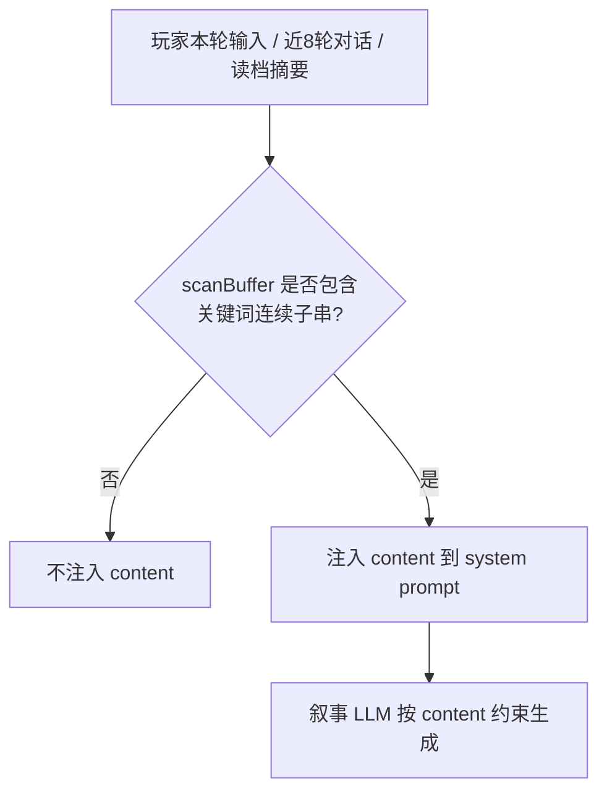

# TXT 补充提示词 — 触发规则与示例

> **受众**：创作者 / 策划 / QA  
> **关联**：[选择性注入计划书](./TXT-morePromptForms-选择性注入计划书.md)（实现细节）· [一句话生成补充提示词规划](./AI一句话生成-补充提示词规划.md)（自动填哪些条）  
> **版本**：v1.0（2026-07-09）

---

## 1. 一句话规则

**未勾选「始终生效」时**：只有当前轮扫描文本里出现**关键词（title 字段）的连续子串**，才会把**内容（content）**发给叙事 LLM；否则该条**完全不注入**。

**勾选「始终生效」时**：每轮都会注入 content，不扫关键词。

---

## 2. 字段与职责（复习）

| 字段 | 创作者填写 | 运行时作用 |
|------|------------|------------|
| **关键词**（title） | 逗号分隔，如 `校规,晚自习` 或单个词 `朱元璋赏赐` | 触发条件；命中才注入 |
| **描述**（description） | 侧栏副标题，≤15 字 | 仅展示，**不参与匹配、不注入 LLM** |
| **内容**（content） | Markdown 规则/剧情后果 | 命中后写入 system prompt |
| **始终生效**（constant） | 勾选框 | 为 true 时每轮注入 content |

- 多个关键词用英文逗号 `,` 或中文逗号 `，` 分隔 → **命中任意一个即可**（OR）。
- **不新增独立 keys 字段**：title 就是 keywords。

---

## 3. 系统每轮扫什么？

玩家发送行动（`action/stream`）时，后端拼一段扫描文本 `scanBuffer`：

```
本轮玩家输入（userAction）
+ 最近 8 条对话（玩家 + AI 旁白/对话均计入）
+ 读档摘要（sessionSummary，从存档继续时可能有）
```

对每条**未勾选始终生效**的条目，在 `scanBuffer` 中做**子串匹配**（中文按字面、不区分英文大小写）。



**注意**：只扫**当前这一轮**的 scanBuffer，没有 sticky（上轮命中、本轮未出现关键词 → 本轮不注入）。

---

## 4. 命中 / 不命中对照表

### 4.1 会触发（✅）

| 情况 | 示例 |
|------|------|
| 玩家本轮输入含关键词 | 关键词 `朱元璋赏赐`，输入「接受**朱元璋赏赐**」 |
| 最近 8 条里 AI 写过关键词 | 上轮旁白：「**朱元璋赏赐**的旨意到了」 |
| 最近 8 条里玩家提过关键词 | 前几轮：「等待**朱元璋赏赐**」 |
| 读档摘要含关键词 | 摘要：「已发生**朱元璋赏赐**…」 |
| 多关键词 OR | title=`校规,晚自习`，出现「晚自习」即命中 |
| 勾选始终生效 | 与对话无关，每轮注入 |

### 4.2 不会触发（❌）

| 情况 | 示例（关键词为 `朱元璋赏赐`） |
|------|--------------------------------|
| 只说相关词、不是连续子串 | 「朱元璋要赏赐我」「皇帝的赏赐」 |
| 只出现部分词 | 仅「朱元璋」或仅「赏赐」 |
| 换说法 | 「洪武皇帝赏赐」「皇上恩赏」 |
| 中间插入多余字 | 「朱元璋的赏赐」「朱元璋大大赏赐」 |
| 剧情相关但 scanBuffer 无词 | 只聊封王、黄金，从未出现「朱元璋赏赐」 |
| 很久以前提过、已滚出 8 条 | 第 20 轮提过，近 8 条 + 摘要都没有 |
| 未勾选始终生效且无任何命中 | 默认状态 |

---

## 5. 示例：「朱元璋赏赐」

### 5.1 创作者配置（截图场景）

| 字段 | 值 |
|------|-----|
| 关键词 | `朱元璋赏赐` |
| 始终生效 | **未勾选** |
| 描述 | 封我为北平王（侧栏展示用） |
| 内容 | 朱元璋开心赏赐了我60两黄金，并封我为北平王 |

### 5.2 业务含义

content 描述的是**已发生的赏赐结果**（60 两黄金 + 北平王）。合理用法是：剧情推进到「赏赐」节点，且对话里出现「朱元璋赏赐」后，再让模型知道**具体赏赐内容**，避免剧透或提前封王。

### 5.3 触发示例

| 玩家/剧情文本 | 是否触发 | 说明 |
|---------------|----------|------|
| `请求朱元璋赏赐` | ✅ | 含连续子串 |
| `接受朱元璋赏赐` | ✅ | 含连续子串 |
| `我想得到朱元璋赏赐` | ✅ | 含连续子串 |
| `向朱元璋讨要赏赐` | ❌ | 「讨要」打断，无「朱元璋赏赐」 |
| `朱元璋要赏赐我黄金` | ❌ | 「要」在璋与赏之间 |
| `请皇帝赏赐` | ❌ | 无「朱元璋赏赐」 |
| `朱元璋` | ❌ | 仅名字 |
| `赏赐` | ❌ | 仅词尾 |
| AI：「于是出现了朱元璋赏赐的时刻」 | ✅ | 近 8 条内 AI 文本命中 |

### 5.4 配置建议

| 需求 | 建议 |
|------|------|
| 仅赏赐场面触发 | 保持单词 `朱元璋赏赐`（当前配置） |
| 多种说法都能触发 | 关键词改为 `朱元璋赏赐,封北平王,赏赐黄金` |
| 整章都要遵守封王设定 | 勾选 **始终生效** |

---

## 6. 与其他设定的关系

| 能力 | 触发方式 | 与补充提示词区别 |
|------|----------|------------------|
| 世界观表单（title/background 等） | 每轮必注入 | 全局主线，不是按需 |
| dynamicEntries | flag / 回合 / 概率 | 状态机，不是文本关键词 |
| **补充提示词 v2** | title 关键词 或 constant | 创作者自由规则，文本命中 |

---

## 7. QA 自测清单

1. 创建触发型条目，关键词 `测试关键词A`，content 写明显可辨认的句子。  
2. **测试体验**，首轮输入无关内容 → 叙事不应体现 content（或模型不应被该句约束）。  
3. 输入含 `测试关键词A` → 叙事应贴近 content。  
4. 勾选始终生效的条目 → 任意输入每轮都应体现 content。  
5. 旧游戏未改条目、保存时无 `constant` 字段 → 行为等同 v1 全量注入（Legacy）。

---

## 8. 实现参考（开发）

| 说明 | 路径 |
|------|------|
| 匹配与 scanBuffer | `Interactive-fiction-backend/services/visual/morePromptForms.js` |
| 叙事注入点 | `services/visual/gameLogic.js` → `buildVisualGameContext` |
| 每轮 action | `interface/handlers/visual/sendActionStream.js` |
| 单测 | `npm run test:morePromptForms`（backend）/ `pnpm test:morePromptForms`（frontend） |

---

## 9. 变更记录

| 日期 | 说明 |
|------|------|
| 2026-07-09 | 初版：通用触发规则 + 「朱元璋赏赐」示例 |
