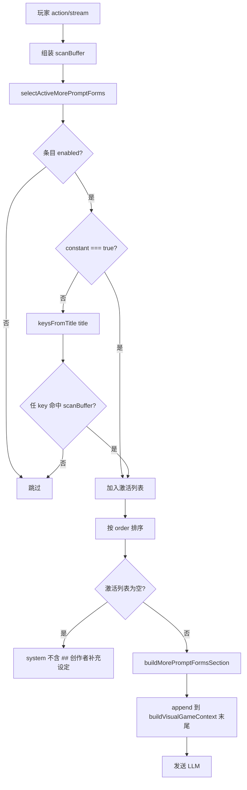
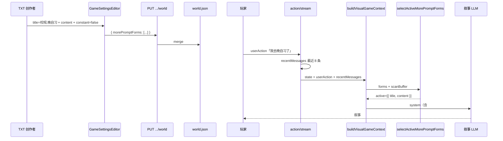

# TXT 补充提示词（morePromptForms）选择性注入 — 完整计划书

> **版本**：v2.0（2026-07-08）  
> **状态**：已实现（选择性注入）  
> **范围**：TXT 引擎 / Kurran Studio Visual 四步编辑器（`/gameSettingsEditor`，`mode !== 'worldInteraction'`）  
> **前置**：v1 已实现侧栏 UI、存储与全量注入，见 [`Visual-morePromptForms-计划书.md`](./Visual-morePromptForms-计划书.md)

---

## 1. 背景与目标

### 1.1 问题

v1 行为：玩家每轮叙事时，**全部** `enabled` 的 `morePromptForms` 条目都会追加到 system prompt 末尾。条目一多会：

- 长期占用 context 窗口；
- 与当前场景无关的规则也被强制注入；
- 无法做「聊到某话题才启用某规则」的剧透控制。

### 1.2 目标（v2）

参照**世界观**里「条件满足才注入 prompt」的思路（`dynamicEntries` 按 flag/回合激活；ST 世界书按 keys 扫描），将 `morePromptForms` 改为：

1. **默认不注入**：每轮组装 prompt 时，初始不带任何补充提示词；
2. **命中才注入**：扫描本轮对话上下文，若条目的 **title（作 keywords）** 命中，则注入该条 **content**；
3. **常驻例外**：勾选 **constant** 的条目，每轮直接注入 **content**，不依赖 title 匹配。

### 1.3 与现有能力的分工

| 层级 | 配置入口 | 存储 | 触发方式 | 典型用途 |
|------|----------|------|----------|----------|
| 世界观核心 | Step 2 世界观表单 | `world.json` 核心字段 | 每轮必注入 | 时代、文风、开场、主角 |
| 动态条目 | 世界观高级 / story-structure | `dynamicEntries` | flag / 回合 / 概率 | 阶段事件、主线推进 |
| **补充提示词 v2** | 侧栏「+ 补充提示词」 | `morePromptForms` | **title 关键词 或 constant** | 校规、地点 lore、禁忌、风格微调 |

---

## 2. 已确认的产品决策

| 项 | 决定 |
|----|------|
| 引擎范围 | **TXT**（Visual 编辑器，`engine=TXT` → galgame 叙事链路） |
| 编辑器范围 | **仅 Visual**（`mode !== 'worldInteraction'`） |
| 数据字段 | 仍用 `worldSetting.morePromptForms`，**不新增 `keys` 字段** |
| **title** | **即 keywords**（逗号分隔触发词）；侧栏主标题同字段 |
| **content** | 命中或 constant 时注入 LLM 的正文（Markdown） |
| **constant** | 布尔：true = 每轮注入 content，不扫描 title |
| **description** | 侧栏副标题，≤15 字，仅展示，不参与匹配、不注入 |
| 条数上限 | 最多 **10** 条（与 v1 一致） |
| 存储与 API | `world.json`，复用 `PUT /api/visual/edit/:fileId/world` |
| 扫描范围 | 本轮 `userAction` + 最近 **8** 条对话 + 可选 `sessionSummary` |
| 匹配规则 | 子串、不区分大小写；title 按 `,` / `，` 拆词，**OR** 命中任一即可 |
| Sticky | **首期不做**；每轮按 scanBuffer 重算（重要规则用 constant） |
| 旧数据兼容 | 无 `constant` 的 v1 条目 → 迁移为 **`constant: true`**（保持全量行为） |

---

## 3. 数据模型

### 3.1 TypeScript 类型（前端）

文件：`src/api/galgame/EditorData.type.ts`

```typescript
/** Visual 侧栏补充提示词；v2：title 作 keywords，constant 作常驻开关 */
export interface MorePromptForm {
  id: string;
  /** 触发型：逗号分隔关键词，如「校规,晚自习」；常驻型：可选展示名 */
  title: string;
  /** 侧栏副标题，不参与匹配 */
  description: string;
  /** 注入 LLM 的正文 */
  content: string;
  /** true = 每轮注入 content，不依赖 title 匹配 */
  constant?: boolean;
  order: number;
  enabled?: boolean;
  updatedAt?: string;
}
```

**v2 相对 v1 变更**：仅增加 `constant?: boolean`；**不增加** `keys[]`。

### 3.2 条目类型

| 类型 | constant | title | content | 运行时 |
|------|----------|-------|---------|--------|
| **触发型**（默认） | `false` / 省略 | 必填，作 keywords | 必填 | title 任一词命中 scanBuffer → 注入 content |
| **常驻型** | `true` | 可选（侧栏展示） | 必填 | 每轮注入 content |

### 3.3 校验规则

| 字段 / 规则 | 规则 |
|-------------|------|
| `title` | 触发型：trim 后非空，且 `split(/[,，]/)` 至少 1 个非空 token |
| `description` | trim 后非空，`Array.from(str).length <= 15` |
| `content` | trim 后非空 |
| `constant` | 可选，默认 `false` |
| 数组长度 | `morePromptForms.length <= 10` |
| `id` | 数组内唯一 |

### 3.4 持久化

```
visual_saves/{fileId}/world.json
  └── morePromptForms: MorePromptForm[]
```

---

## 4. 运行时：选择性注入流程

### 4.1 总流程



### 4.2 scanBuffer 组成

| 来源 | 说明 | 首期 |
|------|------|------|
| 本轮 `userAction` | 玩家输入 | ✅ |
| `recentMessages` | session 最近 8 条 `{ role, content }` | ✅ |
| `sessionSummary` | 读档摘要 `sessionState.sessionSummary` | ✅ |
| 当前场景名 / NPC 名 | 结构化上下文 | 二期可选 |

`buildVisualGameContext` 需增加可选参数：

```typescript
buildVisualGameContext(sessionState, userAction, deps, env, {
  recentMessages?: Array<{ role: string; content: string }>;
})
```

调用方传入：`sendActionStream.js`、`regenerate.js`、编辑 session 试玩链路。

### 4.3 匹配算法（纯函数）

```javascript
/** title 即 keywords：「校规,晚自习」→ ['校规','晚自习'] */
function keysFromTitle(title) {
  return String(title || '')
    .split(/[,，]/)
    .map((s) => s.trim())
    .filter(Boolean);
}

function anyKeyMatch(scanBuffer, keys) {
  const text = String(scanBuffer || '').toLowerCase();
  return keys.some((k) => text.includes(String(k).toLowerCase()));
}

function isMorePromptFormActive(entry, scanBuffer) {
  if (!entry || entry.enabled === false) return false;
  if (entry.constant === true) return true;
  const keys = keysFromTitle(entry.title);
  if (keys.length === 0) return false;
  return anyKeyMatch(scanBuffer, keys);
}
```

### 4.4 注入格式

仅对**激活**条目拼接；**无激活 → 返回空字符串**（关键行为变更）：

```markdown
## 创作者补充设定

### 校规,晚自习
晚自习期间禁止使用手机，发现扣 10 分。

### 全局叙事风格
少用网络梗，对话使用中文引号「」。
```

- 小节标题：使用 **title 原文**（便于日志与 debug）；
- 正文：仅 **content**；
- 其后仍可追加 env `VISUAL_MORE_FORM_TEXT`（与 v1 一致）。

### 4.5 system prompt 注入顺序（不变）

```
1. visual.gm.system 模板（world / player / scene / npc 等）
2. savedHistorySection
3. hiddenSpriteCueSection
4. predefinedNpcPrioritySection
5. dynamicInfoSection（dynamicEntries，按 flag 激活）
6. ## 创作者补充设定  ← v2：仅激活的 morePromptForms
7. VISUAL_MORE_FORM_TEXT
```

### 4.6 与 v1 行为对比

| 场景 | v1 | v2 |
|------|----|----|
| 3 条 enabled，0 命中 | 3 条全进 prompt | **0 条，整段不出现** |
| 用户说「我去晚自习」 | 3 条全进 | 仅 title 含「晚自习」的条目 |
| constant 条目 | 同全量 | 每轮都在 |
| 游戏第一轮 | 全量 | 通常无命中 → 无补充段 |

---

## 5. 配置期：创作者 UX

### 5.1 入口（v1 已有，v2 调整文案）

- 位置：侧栏四步导航下方，`MorePromptNavSection`
- 「+ 补充提示词」→ 右侧 `MorePromptFormPanel`

### 5.2 表单字段（v2）

| 标签 | 字段 | 控件 | 说明 |
|------|------|------|------|
| 关键词 | `title` | `<input>` | placeholder：`校规,晚自习`；触发型必填 |
| 描述 | `description` | `<input maxLength={15}>` | 侧栏副标题 |
| 内容 | `content` | Markdown 单区域 | 注入 LLM 的规则正文 |
| 始终生效 | `constant` | checkbox | 勾选后不依赖关键词，每轮注入 content |

**侧栏展示**：主行 `title`，副行 `description`（与 v1 一致）。

### 5.3 提示文案（i18n 建议）

```json
{
  "createGame": {
    "morePrompt": {
      "titleLabel": "关键词",
      "titlePlaceholder": "逗号分隔，如：校规,晚自习",
      "constantLabel": "始终生效",
      "constantHint": "勾选后每轮都会注入「内容」，不依赖关键词",
      "selectiveHint": "默认不会发给 AI；对话中出现关键词时，才会注入对应「内容」"
    }
  }
}
```

### 5.4 保存链路（与 v1 一致）

```
表单「确定」→ validate → PUT /api/visual/edit/:fileId/world { morePromptForms }
→ merge 写入 world.json → toast → refresh gameData
```

切换面板 / 发布 / 测试体验前：未保存 dirty 拦截（与世界观 `checkBeforeLeave` 对齐，见 Phase 2）。

---

## 6. 旧数据兼容（Legacy）

v1 已上线条目：`title` 多为展示名（如「战斗规则」），非 keyword 串。

| 策略 | 做法 |
|------|------|
| **采用（已确认）** | 读取/迁移时：若条目无 `constant` 字段 → 设为 **`constant: true`** |
| 效果 | 旧游戏保持 v1 全量注入，创作者可逐步改为触发型并改 title 为关键词 |
| 可选 env | `MORE_PROMPT_LEGACY_FULL_INJECT=1` 开发期对照 v1 行为 |

**不建议**：直接把旧 title 当 keywords（「战斗规则」几乎不会自然出现在对话里，会导致规则静默失效）。

---

## 7. 后端改造清单

| 操作 | 路径 | 说明 |
|------|------|------|
| 修改 | `services/visual/morePromptForms.js` | `keysFromTitle`、`buildScanBuffer`、`selectActiveMorePromptForms`；改造 `buildMorePromptFormsSection` / `appendMorePromptFormsToSystemPrompt` |
| 修改 | `services/visual/gameLogic.js` | `buildVisualGameContext` 接收 `recentMessages`，传入 scanContext |
| 修改 | `interface/handlers/visual/sendActionStream.js` | 组装最近 8 条 history 传入 GM |
| 修改 | `interface/handlers/visual/regenerate.js` | 同上 |
| 修改 | `interface/handlers/visual/editRoutes.js` | 校验触发型 title 可解析出 ≥1 key；可选 legacy 迁移 |
| 修改 | `checks/morePromptForms.check.mjs` | 选择性注入单测 |

### 7.1 核心 API 签名（目标）

```javascript
/**
 * @param {Array} forms - worldSetting.morePromptForms
 * @param {{ userAction: string, recentMessages?: Array, sessionSummary?: string }} scanContext
 */
export function selectActiveMorePromptForms(forms, scanContext);

export function appendMorePromptFormsToSystemPrompt(
  systemPrompt,
  worldSetting,
  env,
  scanContext,
);
```

### 7.2 日志（便于 QA）

```
[morePromptForms] total=5 active=2 matched=[校规,晚自习] constant=1 scanLen=1234
```

---

## 8. 前端改造清单

| 操作 | 路径 | 说明 |
|------|------|------|
| 修改 | `src/api/galgame/EditorData.type.ts` | `MorePromptForm` 增加 `constant?` |
| 修改 | `src/utils/morePromptForms.ts` | 校验：触发型 title 至少 1 key；normalize 默认 `constant: false` |
| 修改 | `src/components/GameSettingEditor/MorePromptForms/MorePromptFormPanel.tsx` | constant checkbox；title 标签/placeholder |
| 修改 | `src/i18n/locales/zh.json`、`en.json` | v2 文案 |
| 修改 | `scripts/morePromptForms.check.mjs` | 前端校验单测 |
| 可选 | `src/page/GameSettingsEditor.tsx` | 发布/试玩 dirty 检查（Phase 2） |

---

## 9. 端到端时序



---

## 10. 实施阶段

### Phase 1 — 选择性注入 MVP（约 2d）

| # | 任务 | 负责 |
|---|------|------|
| 1.1 | 后端 `selectActiveMorePromptForms` + scanBuffer | 后端 |
| 1.2 | 改造 `appendMorePromptFormsToSystemPrompt`（无命中不注入） | 后端 |
| 1.3 | `sendActionStream` / `regenerate` 传 `recentMessages` | 后端 |
| 1.4 | 前端 `constant` + title 校验与 UI | 前端 |
| 1.5 | Legacy：`constant: true` 迁移逻辑 | 后端 + 文档 |
| 1.6 | 单测 `test:morePromptForms` 前后端 | 联调 |

**Phase 1 验收**

- [ ] 无命中时 system 不含 `## 创作者补充设定`
- [ ] title=`校规,晚自习`，用户输入含「晚自习」→ 仅该条 content 注入
- [ ] `constant: true` 条目每轮注入
- [ ] 旧 v1 条目迁移后行为与 v1 一致（全量）
- [ ] 试玩 / 正式游玩 / regenerate 三链路一致

### Phase 2 — UX 与观测（约 1d）

| # | 任务 |
|---|------|
| 2.1 | 发布 / 测试体验前 morePrompt dirty 拦截 |
| 2.2 | 侧栏 selectiveHint 与创作者说明 |
| 2.3 | 日志 `[morePromptForms] active=N` 联调文档 |

### Phase 3 — 二期增强（按需）

- Session **sticky**（命中后多轮保持）
- 单轮激活条数上限 + token 预算
- 扫描场景名 / NPC 名
- worldInteraction 编辑器复用侧栏组件

---

## 11. 测试用例

### 11.1 后端单测（`checks/morePromptForms.check.mjs`）

| 用例 | 期望 |
|------|------|
| `forms=[]` | section 为空 |
| 3 条 enabled，scan 无命中 | section 为空 |
| title=`图书馆`, userAction=`去图书馆看看` | 激活 1 条 |
| title=`校规,晚自习`, scan 仅含「晚自习」 | 激活 1 条 |
| `constant: true`, title 空 | 激活 |
| title 空, `constant: false` | 不激活 |
| `enabled: false` | 不激活 |
| 两条命中 | 按 `order` 排序输出 |
| legacy 条目无 constant | 迁移后视为 constant，全量注入 |

### 11.2 前端单测（`scripts/morePromptForms.check.mjs`）

| 用例 | 期望 |
|------|------|
| 触发型 title 仅空格/逗号 | 校验失败 |
| 触发型无 content | 校验失败 |
| constant 型可无有效 key | 校验通过 |

### 11.3 手工 E2E

1. 创建 TXT 游戏 → 世界观确认修改  
2. 添加触发型：`title=校规,晚自习`，`content=禁手机…`  
3. 添加常驻型：`constant=true`，`content=少用网络梗…`  
4. 测试体验 → 首轮无「校规」相关 prompt 段（日志确认）  
5. 输入「我去晚自习」→ 日志 active≥1，叙事遵守校规  
6. 每轮均有常驻 content 对应段落  

---

## 12. 验收标准（上线）

- [ ] Visual/TXT 侧栏「+ 补充提示词」可配置 title / description / content / constant  
- [ ] title 作 keywords（`,` / `，` 分隔），不新增 keys 字段  
- [ ] 无命中时不向 LLM 发送补充设定段  
- [ ] constant 条目每轮注入 content  
- [ ] 保存写入 `world.json`，与世界观字段 merge 互不影响  
- [ ] v1 旧游戏迁移后行为不退化  
- [ ] `npm run test:morePromptForms`（backend）+ `pnpm test:morePromptForms`（frontend）通过  
- [ ] worldInteraction 编辑器仍不展示该侧栏（与 v1 一致）  

---

## 13. 风险与备注

| 风险 | 缓解 |
|------|------|
| 仅扫 userAction 漏命中 | Phase 1 必须传 recentMessages（8 条） |
| 无 sticky 导致规则「闪退」 | 重要规则用 constant；二期 sticky |
| title 过宽误触发 | 文档建议具体词；避免单字 key |
| 创作者把展示名写在 title | UI 改 label 为「关键词」+ hint |
| Markdown 安全 | 继续 `react-markdown` 默认配置 |

---

## 14. 参考文档与代码

| 说明 | 路径 |
|------|------|
| v1 计划（已实现） | `docs/Visual-morePromptForms-计划书.md` |
| TXT 发布流程 | `docs/txt发布流程梳理.md` |
| 端到端时序 | `docs/从一句话生成到发布：端到端时序说明.md` |
| **创作者：触发规则与示例** | `docs/TXT-morePromptForms-触发规则与示例.md` |
| 前端类型 | `src/api/galgame/EditorData.type.ts` |
| 前端 hook | `src/hooks/editor/useMorePromptForms.ts` |
| 侧栏 / 表单 | `src/components/GameSettingEditor/MorePromptForms/` |
| 后端拼接 | `services/visual/morePromptForms.js` |
| 叙事 context | `services/visual/gameLogic.js` → `buildVisualGameContext` |
| 玩家每轮 | `interface/handlers/visual/sendActionStream.js` |
| dynamicEntries 参照 | `services/visual/timedEffects.js` → `checkTimedEffects` |
| ST 世界书 keys 参照 | `mvu-exec-engine` → `matchStEntry` |

---

## 15. 变更记录

| 日期 | 版本 | 说明 |
|------|------|------|
| 2026-07-03 | v1.0 | 初版全量注入，见 Visual-morePromptForms-计划书 |
| 2026-07-08 | v2.1 | 代码落地：选择性注入、constant 字段、SQL schema registry、前后端单测 |
| 2026-07-09 | v2.1.0-docs | 全字段 registry 文档（含 UI tips）；`d1-schema.sql` 种子；`.cursor/rules/visual-world-json-schema-registry.mdc` |
| 2026-07-09 | — | 一句话生成补充提示词完整规划见 [`AI一句话生成-补充提示词规划.md`](./AI一句话生成-补充提示词规划.md) |
