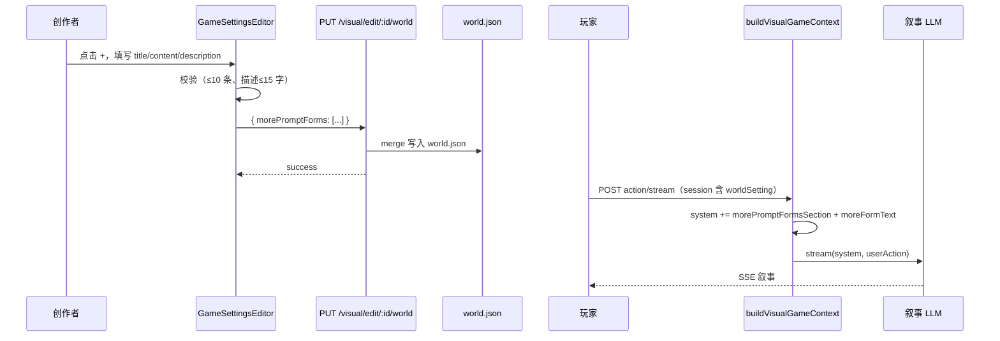

# Visual 动态提示词（morePromptForms）实现计划书

> **版本**：v1.1（2026-07-03）  
> **状态**：已实现（全量注入）  
> **范围**：Visual 四步编辑器 only（不含 worldInteraction 创作端 UI）  
> **后续**：v2 选择性注入（title 作 keywords、constant 常驻）见 [`TXT-morePromptForms-选择性注入计划书.md`](./TXT-morePromptForms-选择性注入计划书.md)

---

## 1. 背景与目标

在 Kuran Studio **Visual 模式**「游戏创作流程」编辑器中，于左侧固定四步导航下方，增加**创作者自定义补充提示词**能力：

- 默认展示「+ 增加」按钮；
- 点击后在**右侧主区域**填写标题、内容（Markdown）、描述（≤15 字）；
- 保存后在侧栏展示条目（标题 + 描述），支持编辑、删除；
- 支持多条（**最多 10 条**）；
- 玩家进入 session 后，叙事 LLM **每轮**在现有 system prompt 末尾追加全部 `morePromptForms` 拼接结果，再追加 `moreFormText`。

与现有 `dynamicEntries` 的区别：

| 能力 | `dynamicEntries` | `morePromptForms`（本需求） |
|------|------------------|----------------------------|
| 触发方式 | 运行时按 flag / 条件激活 | **始终生效**（enabled 条目） |
| 配置入口 | 世界观等面板内嵌 | 侧栏底部独立「+」区块 |
| 用途 | 剧情阶段、条件叙事 | 创作者自由补充设定 / 规则 |

---

## 2. 已确认的产品决策

| 项 | 决定 |
|----|------|
| 数据字段名 | `worldSetting.morePromptForms` |
| 编辑器范围 | **仅 Visual**（`mode !== 'worldInteraction'`） |
| 条数上限 | **最多 10 条** |
| Markdown 交互 | **单区域、不分栏**：默认显示渲染效果；点击进入编辑；失焦或确定后回到渲染态 |
| 描述字数 | **最多 15 个字符**（中文按字计） |
| 存储与 API | 写入 `world.json`，复用 `PUT /api/visual/edit/:fileId/world` |
| 发布 / 测试体验 | 不调用 LLM；数据随 `world.json` 持久化 |
| `moreFormText` | 全局后缀文案；优先环境变量，默认可为空（见 §5.3） |

**首期不做：**

- worldInteraction 编辑器侧栏 UI（字段可预留，二期复用组件）；
- 新增独立 REST 接口；
- 左右分栏 Markdown 编辑器。

---

## 3. 数据模型

### 3.1 TypeScript 类型（前端）

文件：`src/api/galgame/EditorData.type.ts`

```typescript
export interface MorePromptForm {
  id: string;           // crypto.randomUUID()
  title: string;        // 侧栏主标题，必填
  description: string;  // 侧栏副标题，必填，max 15 字
  content: string;      // Markdown 正文，注入 LLM，必填
  order: number;        // 排序，0-based 或 1-based 需统一
  enabled?: boolean;    // 默认 true
  updatedAt?: string;   // ISO8601，可选
}

export interface WorldSetting {
  // ...existing fields
  morePromptForms?: MorePromptForm[];
}
```

### 3.2 持久化位置

```
visual_saves/{fileId}/world.json
  └── morePromptForms: MorePromptForm[]
```

### 3.3 校验规则

| 字段 | 规则 |
|------|------|
| `title` | trim 后非空，建议 max 80 字 |
| `description` | trim 后非空，`Array.from(str).length <= 15` |
| `content` | trim 后非空 |
| 数组长度 | `morePromptForms.length <= 10` |
| `id` | 数组内唯一 |
| `order` | 保存时按当前列表顺序重写 |

---

## 4. UI / UX 设计

### 4.1 侧栏（图 1 参照）

**位置**：`Sidebar.tsx` 内 `<nav>` 四步列表**下方**，仅 `mode === 'visual'` 或默认 visual 时渲染。

**组件**：`MorePromptNavSection`（新建）

| 元素 | 行为 |
|------|------|
| 已保存条目 | 样式复用 `.navBtn` / `.navText`；主行 `title`，副行 `description`；选中态 `.active` |
| 编辑图标 | 选中该条目并在右侧打开表单（同点击条目） |
| 删除图标 | `confirm` 后从列表移除并 `PUT` 保存 |
| 「+ 增加」 | 条目数 `< 10` 时可点；`= 10` 时 disabled + tooltip |
| 禁用态 | Step 1 未完成（`!isParsed` 或 `isParsing`）时与 Step 2–4 一致 disabled |

**样式**：主色 `--primary` / `rgba(224, 61, 75, …)`，与 `Sidebar.module.css` 一致。

### 4.2 右侧表单（图 2 参照）

**组件**：`MorePromptFormPanel`（新建）

**路由**：扩展 `activePanel`：

- `morePrompt:new` — 新建
- `morePrompt:{id}` — 编辑已有

**字段**：

| 标签 | 控件 | 说明 |
|------|------|------|
| 标题 | `<input>` | 单行 |
| 内容 | 单区域 Markdown | 见 §4.3 |
| 描述 | `<input maxLength={15}>` | 实时字数：`还可输入 N 字` |

**按钮**：

- **确定**：校验 → 更新本地列表 → `PUT` 仅 `morePromptForms` → toast → 侧栏刷新
- **取消**：有改动则 confirm；回到上一个 panel 或清空新建态

### 4.3 Markdown 单区域交互

**方案（首期）**：渲染态 / 编辑态同一区域切换

```
默认：react-markdown 渲染 content（加粗、列表、标题等正常显示）
点击内容区：切换为 textarea，自动 focus
失焦 或 父级「确定」：写回 content，回到渲染态
空内容：占位文案「点击输入内容，支持 Markdown」
```

**依赖**：项目已有 `react-markdown@^10.1.0`，无需左右分栏编辑器。

**侧栏**：只展示纯文本 `title` / `description`，不渲染 Markdown。

### 4.4 未保存拦截

在 `GameSettingsEditor.handlePanelChange` 中，当 `activePanel` 以 `morePrompt:` 开头且表单 dirty 时，调用 `checkBeforeLeave`（对齐 `WorldPanel` / `CharactersPanel` 模式）。

---

## 5. 后端与叙事 LLM

### 5.1 写入 API

**现有接口**：`PUT /api/visual/edit/:fileId/world`  
**Handler**：`interface/handlers/visual/editRoutes.js` → `putEditWorld`

请求体示例：

```json
{
  "morePromptForms": [
    {
      "id": "uuid",
      "title": "战斗规则",
      "description": "回合制说明",
      "content": "## 规则\n- 每轮最多 3 行动",
      "order": 0,
      "enabled": true
    }
  ]
}
```

**建议增强**（`putEditWorld` 或独立 validator）：

- 校验数组长度 ≤ 10；
- 校验每条 `description` ≤ 15 字、`title` / `content` 非空；
- 非法时 `400` + 明确 message。

### 5.2 叙事 prompt 拼接

**注入点**：`services/visual/gameLogic.js` → `buildVisualGameContext`  
**时机**：在 `hiddenSpriteCueSection`、`predefinedNpcPrioritySection` 追加之后，`return systemPrompt` 之前。

**新增 helper**（建议新文件 `services/visual/morePromptForms.js`）：

```javascript
export function buildMorePromptFormsSection(forms) {
  const enabled = (Array.isArray(forms) ? forms : [])
    .filter((f) => f && f.enabled !== false && String(f.content || '').trim());
  if (!enabled.length) return '';
  const blocks = enabled
    .sort((a, b) => (a.order ?? 0) - (b.order ?? 0))
    .map((f) => `### ${String(f.title || '').trim()}\n${String(f.content).trim()}`);
  return `\n\n## 创作者补充设定\n${blocks.join('\n\n')}`;
}

export function getMoreFormText(env) {
  return String(env?.VISUAL_MORE_FORM_TEXT || '').trim();
}
```

**最终 system prompt 顺序**：

```
1. visual.gm.system 模板渲染（或 fallback）
2. savedHistorySection
3. hiddenSpriteCueSection
4. predefinedNpcPrioritySection
5. buildMorePromptFormsSection(worldSetting.morePromptForms)   ← 新增
6. getMoreFormText(env)                                         ← 新增
```

### 5.3 `moreFormText` 配置

| 优先级 | 来源 | 说明 |
|--------|------|------|
| 1 | 环境变量 `VISUAL_MORE_FORM_TEXT` | 部署可配，写入 `cf/.dev.vars` / 生产 env |
| 2 | 默认 | 空字符串（不追加） |

**待产品补充**：若需固定后缀文案，在 env 或 `interface/config/` 中维护常量。

### 5.4 影响链路（改一处生效）

- `interface/handlers/visual/sendActionStream.js` — 玩家每轮 `action/stream`
- `interface/handlers/visual/regenerate.js` — 重生成叙事
- `services/prompt/engine.js` — 封装层

Session 初始化已加载 `worldSetting`，**无需改 session 创建 API**。

### 5.5 与 worldInteraction 的关系

- **首期**：worldInteraction **创作端**不展示「+」UI；
- **数据**：`morePromptForms` 存在 `world.json`，若 WI 游戏共用同一 world 文件且走 `buildVisualGameContext`，运行时仍会注入（需二期确认 WI 叙事链路）；
- **二期**：在 `mode=worldInteraction` 的 `Sidebar` 复用 `MorePromptNavSection`。

---

## 6. 前端文件清单

| 操作 | 路径 |
|------|------|
| 新增 | `src/components/GameSettingEditor/MorePromptForms/MorePromptNavSection.tsx` |
| 新增 | `src/components/GameSettingEditor/MorePromptForms/MorePromptNavSection.module.css` |
| 新增 | `src/components/GameSettingEditor/MorePromptForms/MorePromptFormPanel.tsx` |
| 新增 | `src/components/GameSettingEditor/MorePromptForms/MorePromptFormPanel.module.css` |
| 新增 | `src/components/GameSettingEditor/MorePromptForms/MarkdownContentField.tsx` |
| 新增 | `src/hooks/editor/useMorePromptForms.ts`（列表 CRUD + 保存 PUT） |
| 修改 | `src/components/GameSettingEditor/Sidebar.tsx` — 挂载 NavSection（visual only） |
| 修改 | `src/page/GameSettingsEditor.tsx` — panel 路由、未保存拦截、传 props |
| 修改 | `src/api/galgame/EditorData.type.ts` — 类型 |
| 修改 | `src/i18n/locales/zh.json`、`en.json` — 文案 |

---

## 7. 后端文件清单

| 操作 | 路径 |
|------|------|
| 新增 | `services/visual/morePromptForms.js` — section 构建 + 校验 |
| 修改 | `services/visual/gameLogic.js` — `buildVisualGameContext` 末尾追加 |
| 修改 | `interface/handlers/visual/editRoutes.js` — 可选：`morePromptForms` 校验 |
| 修改 | `cf/.dev.vars` 示例 — 注释 `VISUAL_MORE_FORM_TEXT=` |
| 可选 | `checks/morePromptForms.check.mjs` — 拼接单测 |

---

## 8. i18n 键名（建议）

```json
{
  "createGame": {
    "morePrompt": {
      "add": "增加",
      "title": "标题",
      "content": "内容",
      "description": "描述",
      "contentPlaceholder": "点击输入内容，支持 Markdown",
      "descRemaining": "还可输入 {{count}} 字",
      "confirm": "确定",
      "cancel": "取消",
      "delete": "删除",
      "deleteConfirm": "确定删除该提示词？",
      "maxReached": "最多添加 10 条",
      "saveSuccess": "已保存",
      "saveFailed": "保存失败",
      "validationTitle": "请填写标题",
      "validationContent": "请填写内容",
      "validationDescription": "请填写描述（最多 15 字）",
      "unsavedLeave": "有未保存的修改，确定离开？"
    }
  }
}
```

---

## 9. 端到端时序



---

## 10. 实施阶段

| 阶段 | 内容 | 负责 | 预估 |
|------|------|------|------|
| **P0** | 后端 helper + `buildVisualGameContext` 注入 + env + 校验 | 后端 | 0.5d |
| **P1** | 类型、`useMorePromptForms`、PUT 联调 | 前端 | 0.5d |
| **P2** | 侧栏 NavSection + FormPanel + MarkdownContentField | 前端 | 1d |
| **P3** | 未保存拦截、移动端、i18n、删除 confirm | 前端 | 0.5d |
| **P4** | 联调：创建 → 测试体验 → 日志确认 prompt | 联调 | 0.5d |

**PR 建议拆分：**

1. Backend：`morePromptForms.js` + `gameLogic.js` + 可选 check
2. Frontend：UI + hook + GameSettingsEditor 接入

---

## 11. 验收标准

- [ ] Visual 编辑器侧栏底部默认仅「+」，样式与现有 nav active 一致
- [ ] Step 1 未完成时「+」与条目 disabled
- [ ] 创建后侧栏显示 title + description（≤15 字）
- [ ] 内容区 Markdown 渲染正常，单区域编辑无左右分栏
- [ ] 最多 10 条，第 11 条无法添加
- [ ] 编辑、删除、取消、未保存拦截正常
- [ ] 刷新页面 / 重进编辑器数据不丢失
- [ ] 测试体验后，叙事请求 system prompt 含全部 enabled 条目 + `moreFormText`
- [ ] 「直接发布」行为不变（不调 LLM）
- [ ] worldInteraction 编辑器**不出现**该侧栏区块

---

## 12. 风险与备注

1. **`moreFormText` 文案**：产品未定时可先空串，不影响主流程。
2. **Markdown 安全**：渲染侧使用 `react-markdown` 默认不执行 HTML；若需禁止 raw HTML，配置 `rehype-sanitize`（二期）。
3. **并发编辑**：同一 `fileId` 多端编辑以最后一次 `PUT` 为准，与现有 world 编辑一致。
4. **旧游戏兼容**：读取时 `morePromptForms ?? []`，无迁移脚本。

---

## 13. 参考代码位置

| 说明 | 路径 |
|------|------|
| Visual 编辑器入口 | `src/page/GameSettingsEditor.tsx` |
| 侧栏四步 nav | `src/components/GameSettingEditor/Sidebar.tsx` |
| world 保存 API（前端） | `src/api/galgame/EditorData.ts` → `putEditWorld` |
| world 保存 API（后端） | `interface/handlers/visual/editRoutes.js` → `putEditWorld` |
| 叙事 system prompt | `services/visual/gameLogic.js` → `buildVisualGameContext` |
| 玩家每轮叙事 | `interface/handlers/visual/sendActionStream.js` |
| 端到端流程文档 | `docs/从一句话生成到发布：端到端时序说明.md` |

---

## 14. 变更记录

| 日期 | 版本 | 说明 |
|------|------|------|
| 2026-07-03 | v1.0 | 初版：字段 `morePromptForms`、Visual only、最多 10 条、Markdown 单区域 |
| 2026-07-03 | v1.1 | 代码落地：前后端 + 单测 `test:morePromptForms` |
| 2026-07-03 | v1.2 | 补全单测：后端 23 项 / 前端 10 项 |
