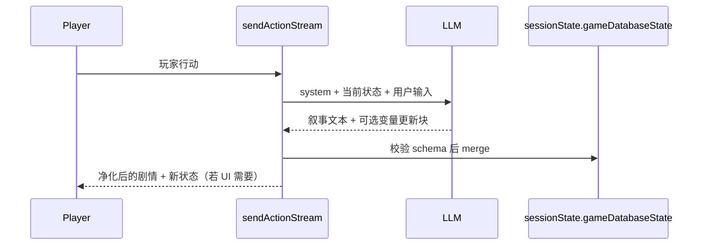

# Visual Step 6「数据库」— 飞书需求实施计划（Phase 2）

> **需求来源**：[飞书文档](https://avyx4ypb3lx.feishu.cn/docx/MSeQdRjzzoXu96xkcVic5vJgnyc)  
> **版本**：v0.1（2026-07-10）  
> **状态**：计划稿（**未开始编码**）  
> **前置交付**：[`Visual-数据库-dataPromptForms-计划书.md`](./Visual-数据库-dataPromptForms-计划书.md)（P0 已实现：Step 6 UI + `dataPromptForms` 文本条目 + 选择性注入）

---

## 0. 文档读取说明（必读）

当前环境**无法直接打开**上述飞书文档正文（权限/超时）。本计划基于以下信息推演：

| 依据 | 说明 |
|------|------|
| 飞书链接 | 产品正式需求入口 |
| P0 已交付 | Step 6 侧栏 + `dataPromptForms` 与 Step 5 同形表单 |
| 仓库内参考 | [`tavern-card-helper`](../tavern-card-helper) 的 MVU 变量体系（Zod schema / initvar / 更新规则） |
| Kuran 现有能力 | `morePromptForms` 选择性注入、`dynamicEntries` flag 激活、`sessionState` 存档 |

**请你确认或补充飞书文档中的以下要点**（确认后本计划可升级为 v1.0 并开工）：

1. 「数据库」最终形态是 **文本 Lore 条目**、**结构化变量（MVU）**，还是 **两者并存**？
2. 运行时是否要 **AI 自动改数值/状态**（JSON Patch），还是仅 **只读注入**？
3. 一句话生成是否要自动填充 `dataPromptForms`（类比 morePrompt Step 4/4）？
4. 与 Step 5「游戏系统」的边界：哪些规则放 `morePromptForms`，哪些放 `dataPromptForms`？

---

## 1. 现状（P0，已完成）

### 1.1 已有什么

| 能力 | 说明 |
|------|------|
| 编辑器 Step 6 | 侧栏「数据库」，左右分栏，表单字段同 Step 5 |
| 数据 | `world.json` → `worldSetting.dataPromptForms[]` |
| 条目字段 | `title`（关键词）、`constant`、`content`、`description`、`order`、`enabled` |
| 保存 | `PUT /api/visual/edit/:fileId/world` |
| 叙事注入 | 命中关键词或始终生效 → 拼入 `## 游戏数据库` 段落 |
| 测试 | 前后端 `test:dataPromptForms` + `test:dataPromptPanel` 已通过 |

### 1.2 P0 的定位（当前）

**把「数据库」当作第二套「选择性注入的 Lore 文本库」**，与 Step 5 `morePromptForms` 对称：

```
Step 5 游戏系统  → morePromptForms → ## 创作者补充设定
Step 6 数据库    → dataPromptForms → ## 游戏数据库
```

### 1.3 P0 的局限（Phase 2 要解决的）

| 局限 | 影响 |
|------|------|
| 无结构化字段 | 无法表达「好感度 72」「库存 {剑:1}」等可计算状态 |
| 无会话态写入 | AI 不能可靠地「记住并更新」变量，只能靠文本复述 |
| 无 schema 校验 | 创作者手写 Markdown，易出现前后矛盾 |
| 与 MVU/ST 生态割裂 | 无法导出/对齐 SillyTavern MVU 卡片规范 |
| 无自动生成 | 一句话生成只写 `morePromptForms`，不写 `dataPromptForms` |

---

## 2. 目标定义（Phase 2 建议）

在 **不破坏 P0 已有存档** 的前提下，把 Step 6「数据库」升级为 **「创作者可配置的游戏状态数据库」**：

| 维度 | P0（现状） | P2（目标） |
|------|------------|------------|
| 创作者配置 | 文本条目（关键词 + 内容） | **保留文本条目** + 可选 **变量 schema** |
| 运行时读取 | 选择性注入 Markdown | 注入 **当前状态快照** + 可选 Lore 条目 |
| 运行时写入 | 无 | **结构化变量更新**（受 schema / 规则约束） |
| 存档 | 仅 `world.json` | `world.json`（定义）+ `sessionState`（实例值） |
| 与 Step 5 分工 | 双 Lore 库 | 游戏系统=规则；数据库=**事实与状态** |

### 2.1 产品分工（建议默认）

| 模块 | 存储 | 典型内容 | 注入时机 |
|------|------|----------|----------|
| Step 5 游戏系统 | `morePromptForms` | 叙事规则、文风、禁忌、玩法说明 | 关键词 / 始终生效 |
| Step 6 数据库 | `dataPromptForms` + **新：变量定义** | 角色关系数值、物品、任务进度、地点事实 | 关键词 / 始终生效 + **每轮状态块** |
| Step 2 世界观 | `world.json` 核心字段 | 时代、开场、主角 | 每轮必注入 |
| 动态条目 | `dynamicEntries` | 阶段事件 | flag / 回合 |

---

## 3. 数据模型演进方案

### 3.1 方案 A（推荐）：双层模型 — Lore 条目 + 变量库

在 `worldSetting` 增加 **变量定义层**，与现有 `dataPromptForms` 并存：

```typescript
// world.json（定义态，创作者在 Step 6 编辑）
interface WorldSetting {
  dataPromptForms?: DataPromptForm[];     // P0 保留
  gameDatabase?: GameDatabaseDefinition;  // P2 新增（命名待产品确认）
}

interface GameDatabaseDefinition {
  version: '1.0';
  /** MVU 风格变量树（参考 tavern-card-helper MvuConfig） */
  schema: GameDatabaseSchemaSection[];
  /** 新游戏/新存档时的初始值 */
  initValues: Record<string, unknown>;
  /** AI 允许更新的路径与规则（可选） */
  updateRules?: GameDatabaseUpdateRule[];
  /** 是否启用结构化变量（false 时仅走 P0 文本条目） */
  enabled: boolean;
}

// session 存档（实例态，玩家游玩时更新）
interface SessionState {
  // 现有字段…
  gameDatabaseState?: Record<string, unknown>;  // 当前变量快照
}
```

**兼容策略**：

- 旧存档无 `gameDatabase` → 仅使用 `dataPromptForms`（P0 行为不变）
- 有 `gameDatabase.enabled=true` → 叙事 prompt 额外拼 `## 当前游戏状态` JSON/YAML 块

### 3.2 方案 B（激进）：废弃文本条目，全面 MVU 化

- Step 6 UI 改为 `tavern-card-helper` 式「变量区段 + 变量表 + 更新规则」
- `dataPromptForms` 标记 deprecated，迁移工具把 content 转成只读 `_` 前缀变量

**风险**：改动面大、与 P0 产品承诺冲突。**不建议**作为首期，除非飞书文档明确要求。

### 3.3 方案 C（最小）：仅增强 P0 文本库

- 不加结构化变量
- 补：一句话自动生成 `dataPromptForms`、条目模板、与 morePrompt 去重校验

**适用**：飞书需求只是「补全 Lore 能力」而非「状态机」。

---

## 4. UI / 交互计划（方案 A）

Step 6 在现有左右分栏上，增加 **Tab 或子导航**（不新增 Step 7）：

```
数据库
├── [数据条目]     ← 现有 dataPromptForms（P0）
├── [变量结构]     ← schema 树形编辑（参考 StepMvuVariables）
├── [初始值]       ← initValues 表单 / YAML 预览
└── [更新规则]     ← 可选：AI 什么情况下可改哪些字段
```

| 区域 | 复用来源 | 说明 |
|------|----------|------|
| 左菜单 + 右表单 | 现有 `DatabasePanel` | 数据条目 Tab 不变 |
| 变量结构编辑器 | `tavern-card-helper/src/components/wizard/StepMvuVariables.tsx` | 抽公共组件或复制适配 |
| Schema 生成 | `tavern-card-helper/src/services/mvu-builder.ts` | 生成 Zod/初始化/规则文案 |
| 预览 | 只读 JSON + 「注入预览」 | 显示下轮 narrative 会看到的状态块 |

**未保存离开**：各 Tab 独立 `checkBeforeLeave`，切换 Step 5/6 时统一拦截。

---

## 5. 后端 / 运行时计划

### 5.1 叙事 LLM 组装顺序（建议）

```
1. 世界观 / 角色 / 场景（现有）
2. dynamicEntries（flag 激活）
3. ## 创作者补充设定（morePromptForms 命中）
4. ## 游戏数据库（dataPromptForms 命中）        ← P0
5. ## 当前游戏状态（gameDatabaseState 快照）    ← P2 新增
6. moreFormText（env 后缀）
```

### 5.2 状态更新链路（P2 核心）



| 环节 | 文件（预估） | 工作 |
|------|--------------|------|
| 定义校验 | `services/visual/gameDatabase.js` | validate schema / init / rules |
| 存档读写 | `sessionState` 迁移 + save/load | 与现有存档版本并存 |
| Prompt 拼接 | `gameLogic.js` | `buildGameDatabaseStateSection()` |
| 更新解析 | `services/visual/gameDatabasePatch.js` | 从 LLM 输出提取 JSON Patch / 专用块 |
| PUT 保存 | `editRoutes.js` | `body.gameDatabase` 校验 |

### 5.3 与 `dynamicEntries` / flags 的关系

| 能力 | 触发 | 适合 |
|------|------|------|
| `dynamicEntries` | flag / 回合 / 概率 | 阶段性世界事件文案 |
| `dataPromptForms` | 关键词 | 话题相关 Lore |
| `gameDatabaseState` | 每轮（或按规则） | 数值、 inventory、关系量表 |

避免三者重复注入同一事实：计划内增加 **去重/优先级** 配置（P2.1）。

---

## 6. 一句话生成扩展（可选 Phase）

类比 [`AI一句话生成-补充提示词规划.md`](./AI一句话生成-补充提示词规划.md)：

| 步骤 | 现状 | P2 建议 |
|------|------|---------|
| Step 4/4 | 生成 `morePromptForms` | 增加 **Step 5/5** 或合并为 4b：生成 `dataPromptForms` 草稿 |
| 变量 schema | 无 | 可选：根据 NPC/场景生成 **精简 initValues**（好感度初值、关键物品） |

**LLM 提示词位置**：`cf/src/prompts/visualDocPrompts.js`（与 `MORE_PROMPT_FORMS_IDEA_SYSTEM` 并列）

**默认条数建议**（待产品确认）：

| 类型 | 条数 | constant |
|------|------|----------|
| 世界事实库 | 2～3 | 部分始终生效 |
| 角色关系/立场 | 2～3 | 关键词触发 |
| 关键道具/任务状态 | 1～2 | 关键词触发 |

---

## 7. 分期交付建议

| 阶段 | 范围 | 预估 | 依赖 |
|------|------|------|------|
| **P2.0 需求冻结** | 对照飞书文档确认 §0 四个问题 | 0.5d | 产品输入 |
| **P2.1 数据模型** | `gameDatabase` 定义 + D1 registry + 迁移 | 1d | 方案 A/B 选定 |
| **P2.2 编辑器 UI** | Step 6 多 Tab + 变量结构编辑 | 2～3d | 可复用 tavern-card-helper |
| **P2.3 运行时只读** | 状态块注入 narrative（不写入） | 1d | P2.1 |
| **P2.4 运行时写入** | LLM 输出解析 + schema merge + 存档 | 2～3d | P2.3 |
| **P2.5 自动生成** | 一句话生成 dataPrompt / initValues | 1～2d | 可选 |
| **P2.6 测试与文档** | 单测 + 端到端存档回归 | 1d | 全程 |

**总估**：约 **8～12 人日**（方案 A，含只读+写入）；方案 C 约 **2～3 人日**。

---

## 8. 测试计划（Phase 2 交付门槛）

### 8.1 后端单测

| 模块 | 用例 |
|------|------|
| `gameDatabase.js` | schema 校验、initValues 默认值、路径唯一性 |
| `gameDatabasePatch.js` | 合法 patch 合并、越界 clamp、非法路径拒绝 |
| `gameLogic` | 状态块注入顺序、与 morePrompt/dataPrompt 不冲突 |
| `editRoutes` | PUT 往返、旧存档无 gameDatabase 不报错 |
| 存档迁移 | v1 session 加载后 `gameDatabaseState` 为空对象 |

### 8.2 前端单测

| 模块 | 用例 |
|------|------|
| schema 编辑器纯函数 | 增删变量、路径生成、enum/range 解析 |
| Step 6 路由 | Tab 切换不串 panel id |
| 校验 | 与后端限制一致（条数、字段必填） |

### 8.3 集成 / 手工

1. 仅 P0 旧存档：Step 6 数据条目仍可用，无状态块  
2. 启用 P2 后新游戏：叙事中出现状态快照；多轮后变量按规则变化  
3. Step 5 / Step 6 同时有条目：注入顺序与去重符合预期  
4. 一句话生成（若做 P2.5）：完成后 Step 6 有草稿条目  

---

## 9. 风险与回滚

| 风险 | 缓解 |
|------|------|
| 飞书需求与推演不符 | §0 确认后再编码；计划版本化 |
| Token 膨胀（状态块过大） | 只注入「本轮相关」子树；hidden `$` 前缀变量不注入 |
| LLM 乱改变量 | schema + updateRules 白名单；失败则忽略 patch 仅保留叙事 |
| 与 P0 存档冲突 | `gameDatabase` 可选字段；默认 `enabled: false` |
| 重复建设 tavern-card-helper | 抽 `mvu-builder` 为 workspace 共享包，或子模块 git submodule |

**回滚**：关闭 `gameDatabase.enabled` 即回退到 P0 纯文本 `dataPromptForms` 行为。

---

## 10. 待产品确认清单（来自飞书）

请对照 [飞书文档](https://avyx4ypb3lx.feishu.cn/docx/MSeQdRjzzoXu96xkcVic5vJgnyc) 勾选或补充：

- [ ] 采用方案 **A / B / C**？
- [ ] 变量是否需要 **玩家可见 UI**（数值面板），还是仅后台给 LLM？
- [ ] AI 更新变量：每轮自动解析，还是仅 GM/脚本事件触发？
- [ ] `dataPromptForms` 与结构化变量 **是否长期并存**？
- [ ] 是否需要 **导出为 ST/MVU 卡片**（与 tavern-card-helper 互通）？
- [ ] 一句话生成是否纳入本期？

---

## 11. 修订记录

| 日期 | 版本 | 说明 |
|------|------|------|
| 2026-07-10 | v0.1 | 基于飞书链接 + P0 现状 + MVU 参考推演；待飞书正文确认 |
