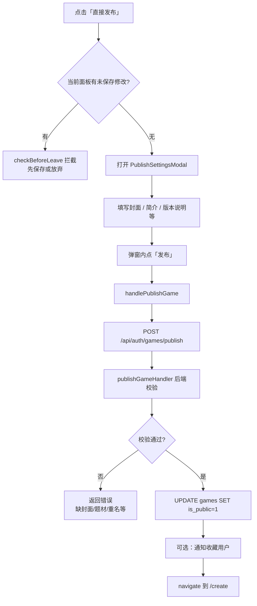
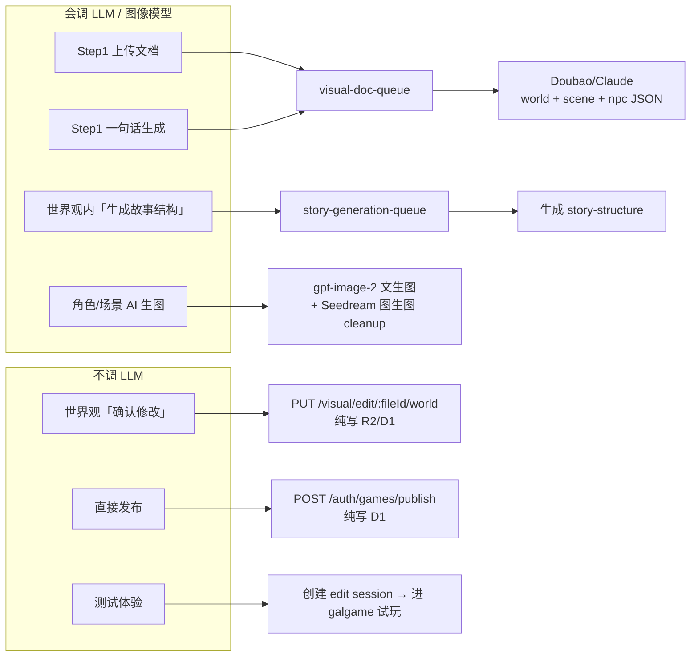

## 结论先说

**「直接发布」点击后不会调用大模型。**

它做的是：校验未保存修改 → 打开发布弹窗 → 提交发布 API → 把游戏标记为公开（`is_public = 1`）。  
大模型只在创作流程的**其他步骤**里用到（文档解析、一句话生成、故事结构生成、AI 生图等），和发布是分开的。

---

## 一、「直接发布」完整链路



### 前端关键代码

| 步骤 | 文件 | 行为 |
|------|------|------|
| 按钮点击 | `GameSettingsEditor.tsx` | `checkActivePanelBeforeAction()` → `setShowPublishModal(true)` |
| 弹窗提交 | `PublishSettingsModal.tsx` | 校验封面+简介 → 调 `onPublish()` |
| 发布请求 | `useEditorSession.ts` | `GameAction.publishGame({ fileId, priceAmount: 0, description, shareType, ... })` |
| API | `gameAction.ts` | `POST /auth/games/publish` |

### 后端 `publishGameHandler` 做什么（**无 LLM**）

```134:333:interface/handlers/games/gamesPublish.js
export async function publishGameHandler(c) {
    // 校验：登录、fileId、创作者身份、封面、题材标签、标题不重复
    // 写入：is_public=1, description, share_type, version_notes, price_amount
    // 可选：notifyFavoritedUsersOnGameUpdate
}
```

发布前硬性条件包括：

- 已登录且是创作者本人  
- `games.cover_url` 不为空（弹窗里上传封面）  
- 至少 1 个题材标签（`game_tag_map`）  
- 公开游戏中标题不能重复  
- AVG 类型需传 `shareType`（积分/钻石结算）

---

## 二、大模型在创作流程里何时被调用

「直接发布」不调 LLM，但同页面的其他操作会：



### 1. 文档上传 / 一句话生成（Step 1）

| 入口 | 前端 API | 后端 | 队列 | LLM |
|------|----------|------|------|-----|
| 上传 Word/PDF | `POST /optical/games/upload` | 入队 | `visual-doc-queue` | ✅ |
| 一句话生成 | `POST /visual/document/generate-from-idea` | 入队 | `visual-doc-queue` | ✅ |

消费者：`cf/src/queue/visualDocConsumer.js`

- `processVisualDocJob`：解析文档 → 依次生成 `worldSetting` → `sceneSetting` → `npcSetting`  
- `processGenerateFromIdeaJob`：从 idea 文本直接生成上述三块 JSON  

模型：默认 `doubao-seed-1-8-251228`（或 Claude，看 `LLM_PROVIDER`），通过 `doubaoCompleteWithSchema` / `llmStream`。

前端轮询：`useFileUpload.ts` → `checkUploadStatus(jobId)`。

### 2. 世界观「确认修改」（你截图当前步骤）

| 操作 | API | LLM |
|------|-----|-----|
| 保存世界观 | `PUT /visual/edit/:fileId/world` | ❌ 只写存储 |
| 保存题材标签 | `gameTagsApi.setGameTagsForGame` | ❌ |

逻辑在 `useEditorSubmit.ts` 的 `handleSubmit`，**纯 CRUD**。

### 3. 故事结构生成（世界观高级功能，需手动点）

| 操作 | API | 队列 | LLM |
|------|-----|------|-----|
| 生成 story-structure | `POST /visual/edit/:fileId/story-structure/generate` | `story-generation-queue` | ✅ |

Handler：`interface/handlers/visual/storyGeneration.js`  
前端 API 已定义（`EditorApi.generateStoryStructure`），UI 在 `StoryStructureAdvanced.tsx`，**与「直接发布」无关**。

### 4. AI 生图（角色/场景面板，可选）

| 操作 | API | 模型 |
|------|-----|------|
| 批量/单张生图 | `/visual/generate-images/...` | 文生图 `gpt-image-2`；cleanup/变体用 Doubao Seedream |

这是你之前遇到的 `doubao-seedream-4-5-251128` 报错场景，属于**生图**，不是发布。

### 5. 「测试体验」按钮（对比参考）

- 调 `createGalgameEditSession` → 创建试玩 session → 跳转 `/galgame`  
- **不调 LLM**，只是进游戏试玩。

---

## 三、和你截图的对应关系

你当前在 **Step 2 世界观表单**（`activePanel = 'world'`）：

1. **「直接发布」** → 只检查未保存 → 打开发布弹窗 → 写 D1 公开状态  
2. **不会**再跑文档解析、一句话生成或 Seedream 生图  
3. 若世界观/题材还没「确认修改」保存，或题材标签未选，发布可能被拦（前端题材校验 + 后端 `game_tag_map` 校验）

---

## 四、和同事核对时可用的清单

| 问题 | 答案 |
|------|------|
| 直接发布会不会调大模型？ | **不会** |
| 发布改的是哪张表？ | `games`（`is_public`, `description`, `share_type` 等） |
| 内容从哪来？ | 之前 Step1 解析/生成 + Step2~4 手动编辑保存的结果 |
| 发布失败常见原因？ | 无封面、无题材标签、标题重复、非创作者 |
| LLM 主要在哪？ | `visualDocConsumer.js`（世界观/场景/NPC JSON）、`story-generation` 队列、运行时 `sendActionStream` 叙事 |

如果你需要，我可以再单独梳一版「从一句话生成到发布」的**时序图**（含 jobId 轮询字段），方便发给同事做联调文档。