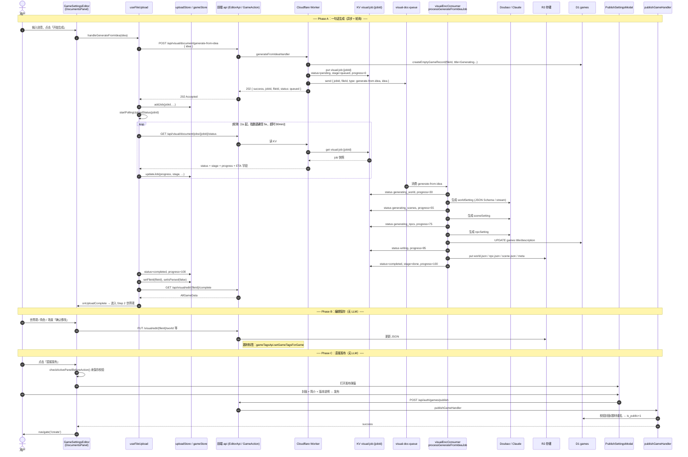

# 从一句话生成到发布：端到端时序说明

> Visual 模式（`/gameSettingsEditor`）创作流程梳理，供前后端联调与多人协作核对。  
> 代码基准：`Interactive-fiction-frontend` + `Interactive-fiction-backend`。  
> **扩展计划**：一句话生成自动填充补充提示词 → [`AI一句话生成-补充提示词规划.md`](./AI一句话生成-补充提示词规划.md)

---

## 1. 总览

| 阶段 | 是否调用 LLM | 说明 |
|------|-------------|------|
| Step 1：一句话生成 | ✅ 是 | 异步队列 + KV 状态轮询（4 步：世界观 / 场景 / 角色 / 补充提示词） |
| Step 2~4：世界观 / 角色 / 场景编辑 | ❌ 否（保存为 CRUD） | 可选：故事结构生成、AI 生图为独立异步任务 |
| 直接发布 | ❌ 否 | 仅更新 D1 `games` 公开状态 |

**重要**：`generate-from-idea` 时 **`fileId` 与 `jobId` 相同**（后端创建时共用同一 32 位 hex）。

---

## 2. 主时序图（一句话生成 → 编辑 → 发布）



---

## 3. 一句话生成：接口与 jobId 轮询

### 3.1 提交任务

| 项 | 值 |
|----|-----|
| 方法 | `POST` |
| 路径 | `/api/visual/document/generate-from-idea` |
| 鉴权 | 需要登录 |
| 请求体 | `{ "idea": string }`（trim 后 ≥ 10 字符） |
| 前端入口 | `EditorApi.generateGameFromIdea` → `useFileUpload.handleGenerateFromIdea` |

**202 响应示例**（`generateFromIdeaHandler`）：

```json
{
  "success": true,
  "jobId": "a1b2c3...",
  "fileId": "a1b2c3...",
  "status": "queued",
  "message": "游戏创意已提交，正在生成中..."
}
```

> `jobId === fileId`；KV key 为 `visual:job:{jobId}`。

### 3.2 轮询状态

| 项 | 值 |
|----|-----|
| 方法 | `GET` |
| 路径 | `/api/visual/document/jobs/:jobId/status` |
| 前端入口 | `EditorApi.checkUploadStatus(jobId)` |
| 实现 | `interface/routes/visualExtra.js` 读 KV + `withUploadEstimate` |

**前端轮询策略**（`useFileUpload.startPollingUploadStatus`）：

| 参数 | 值 |
|------|-----|
| 首次间隔 | 1000 ms |
| 最大间隔 | 5000 ms（每次 ×1.3 退避） |
| 总超时 | 30 分钟 |
| 完成/失败后 | 2~3 秒后从 `uploadStore` 移除 job |

**前端对 `status` 的处理**：

| 后端 `status` | 前端 uploadStore | 行为 |
|---------------|------------------|------|
| `pending` / `queued` | `uploading` | 继续轮询 |
| `running` | `processing` | 继续轮询，展示 `stage` / `progress` |
| `completed` | `completed` | `setFileId` → `fetchEditorData` → 移除 job |
| `failed` | `failed` | toast 错误 → 移除 job |
| `unknown`（KV 无记录） | `failed` | job 不存在或已过期 |

### 3.3 轮询响应字段（CheckUploadStatusResponse）

后端 KV 原始字段 + ETA 扩展（`withUploadEstimate`）：

| 字段 | 类型 | 说明 |
|------|------|------|
| `success` | boolean | 后端：`status === 'completed'` 时为 true |
| `jobId` | string | 与 fileId 相同（一句话生成） |
| `fileId` | string | 游戏 ID |
| `status` | string | `pending` \| `queued` \| `running` \| `completed` \| `failed` |
| `stage` | string | 细粒度阶段，见下表 |
| `progress` | number | 0~100 |
| `error` | string? | 失败原因 |
| `updatedAt` | string? | ISO 时间 |
| `createdAt` | string? | ISO 时间 |
| `jobKind` | string? | 一句话生成为 `visual-idea` |
| `elapsedSeconds` | number? | 已耗时（ETA 计算） |
| `estimatedRemainingSeconds` | number? | 预估剩余秒数 |
| `estimatedTotalSeconds` | number? | 预估总时长 |
| `estimateSource` | string? | 如 `stage-baseline+progress` |

### 3.4 一句话生成 stage / progress 对照

Consumer：`cf/src/queue/visualDocConsumer.js` → `processGenerateFromIdeaJob`

| stage | progress | 后端动作 |
|-------|----------|----------|
| `queued` | 0 | 入队，KV 初始 `pending` |
| `generating_world` | 30 | LLM 生成 `worldSetting` |
| `generating_scenes` | 55 | LLM 生成 `sceneSetting` |
| `generating_npcs` | 75 | LLM 生成 `npcSetting` |
| `generating_more_prompts` | 85 | LLM 生成 `world.json` → `morePromptForms`（3～6 条，失败则规则兜底） |
| `writing` | 95 | 写入 R2 + 更新 D1 `games` |
| `done` | 100 | KV `status=completed` |

**LLM 模型**（默认）：`doubao-seed-1-8-251228`（Doubao JSON Schema 或 Claude stream，取决于 `LLM_PROVIDER` / `useDoubaoWithSchema`）。

**R2 产出**：

- `public/visual/{fileId}/world.json`
- `public/visual/{fileId}/npc.json`
- `public/visual/{fileId}/scene.json`
- `public/visual/meta/{fileId}.json`

可选探测：`GET /api/visual/document/jobs/:jobId/result`（检查 R2 四文件是否就绪，**前端当前未用此接口轮询**）。

---

## 4. 编辑阶段（Step 2~4）

生成完成后前端 `useEditorData` 拉取：

```
GET /api/visual/edit/:fileId/complete  →  AllGameData
```

各面板「确认修改」走 `useEditorSubmit.handleSubmit`，**不调用 LLM**：

| 面板 | 主要 API |
|------|----------|
| 世界观 | `PUT /api/visual/edit/:fileId/world` + `setGameTagsForGame` |
| 角色 | NPC CRUD + 图片上传/生成（见下） |
| 场景 | Scene CRUD + 图片上传/生成 |

### 4.1 可选：故事结构生成（独立 job，非发布流程）

| 提交 | `POST /api/visual/edit/:fileId/story-structure/generate` |
| 轮询 | `GET /api/visual/story-generation/jobs/:jobId/status` |
| 结果 | `GET /api/visual/story-generation/jobs/:jobId/result` |
| 队列 | `story-generation-queue` |
| KV key | `story-gen:job:{jobId}` |

前端 API 已定义（`EditorApi.generateStoryStructure`），UI 在 `StoryStructureAdvanced.tsx`。

### 4.2 可选：AI 生图（独立 job）

| 提交 | `POST /api/visual/generate-images/:fileId/jobs` 等 |
| 轮询 | `GET /api/visual/generate-images/jobs/:jobId/status` |
| 模型 | 文生图 `nano-banana`；场景 cleanup / 变体 `doubao-seedream-*` |

与「直接发布」无直接关系；未生图也可发布（仅无立绘/场景图）。

---

## 5. 直接发布

### 5.1 前端链路

```
GameSettingsEditor「直接发布」
  → checkActivePanelBeforeAction()   // 当前面板未保存则拦截
  → PublishSettingsModal
  → useEditorSession.handlePublishGame
  → GameAction.publishGame
  → POST /api/auth/games/publish
  → navigate('/create')
```

**请求体**（`handlePublishGame` 固定 `priceAmount: 0`）：

```json
{
  "fileId": "string",
  "priceAmount": 0,
  "description": "string",
  "shareType": "points | diamonds",
  "versionNotes": "string",
  "notifyFavoritedUsers": false
}
```

AVG 模式弹窗会传 `shareType`；引擎为 TXT 时后端强制 `points`。

### 5.2 后端校验（无 LLM）

`interface/handlers/games/gamesPublish.js` → `publishGameHandler`：

1. 登录 + `fileId` 存在  
2. 当前用户 === `creator_user_id`  
3. `games.cover_url` 非空（弹窗内上传封面）  
4. `game_tag_map` 至少 1 条题材  
5. 公开游戏中标题不重复  
6. 非 TXT 游戏必须合法 `shareType`  
7. `UPDATE games SET is_public = 1, description, share_type, version_notes, ...`  
8. 可选：`notifyFavoritedUsersOnGameUpdate`

---

## 6. 相关源码索引

### 前端

| 文件 | 职责 |
|------|------|
| `src/page/GameSettingsEditor.tsx` | 直接发布 / 测试体验入口 |
| `src/hooks/editor/useFileUpload.ts` | 一句话生成 + job 轮询 |
| `src/hooks/editor/useEditorSubmit.ts` | 各面板保存 |
| `src/hooks/editor/useEditorSession.ts` | 发布 / 试玩 session |
| `src/components/CommonModal/PublishSettingsModal.tsx` | 发布弹窗 |
| `src/api/galgame/EditorData.ts` | generate-from-idea / status / edit API |
| `src/api/galgame/EditorData.type.ts` | `CheckUploadStatusResponse` 等类型 |
| `src/api/rpgGame/gameAction.ts` | `POST /auth/games/publish` |

### 后端

| 文件 | 职责 |
|------|------|
| `interface/handlers/visual/generateFromIdea.js` | 入队 + 202 |
| `cf/src/queue/visualDocConsumer.js` | `processGenerateFromIdeaJob` + LLM |
| `interface/routes/visualExtra.js` | `GET .../document/jobs/:jobId/status` |
| `interface/utils/uploadEta.js` | `withUploadEstimate` |
| `interface/handlers/games/gamesPublish.js` | 发布 |
| `cf/wrangler.toml` | `visual-doc-queue` consumer 须启用 |

---

## 7. 联调排查清单

| 现象 | 可能原因 |
|------|----------|
| progress 长期 0 / stage=queued | `visual-doc-queue` consumer 未启用 |
| status=unknown | KV 过期（7 天 TTL）或 jobId 错误 |
| 发布报缺题材 | Step 2 未保存题材标签 |
| 发布报缺封面 | 发布弹窗未上传封面 |
| 生图失败 ModelNotOpen | Ark 未开通 Seedream（与发布无关） |

---

*文档版本：2026-07-03*
