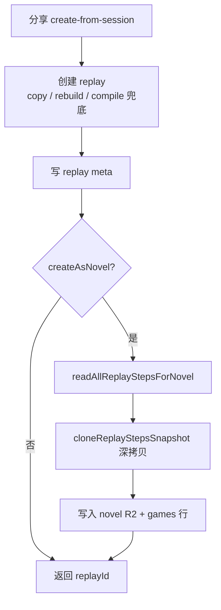

# 回放与小说录制流程（方案 B）

> 更新：2026-07-10  
> 关联：`回放创建小说-计划书.md`  
> 说明：已撤销方案 C，当前采用方案 B。

## 方案 B 原则

1. **先建回放**：分享时先用 history 同步 session replay steps（含玩家原话），再复制到 replay；仍保留 compileFromHistory 兜底。
2. **游玩落盘**：每轮同时写入玩家台词 + assistant steps。
2. **小说深拷贝**：回放落盘成功后，从 **replay R2** 读取全量 steps，**深拷贝**写入 `public/visual/novels/{novelFileId}/content.json`。
3. **相互独立**：小说与回放 R2 文件分离；删除或修改回放不影响已生成的小说正文。
4. **播放不调 AI**：回放页只读已存 steps，本地队列推进。

## 创建流程



## 与方案 C 的差异

| 项 | 方案 C（已撤销） | 方案 B（当前） |
|----|------------------|----------------|
| 游玩落盘 | 强制玩家台词 + choice 全量追加 | 恢复原有增量落盘 |
| 创建回放 | 只复制，无兜底 | 保留 rebuild / compileFromHistory 兜底 |
| 小说来源 | 从 session 复制 | 从 **replay** 深拷贝 |
| 关联 | 同次分享关联 replayId | 同左，但正文独立存储 |

## 验证

```bash
cd Interactive-fiction-backend
npm run test:novelFromReplay
```
